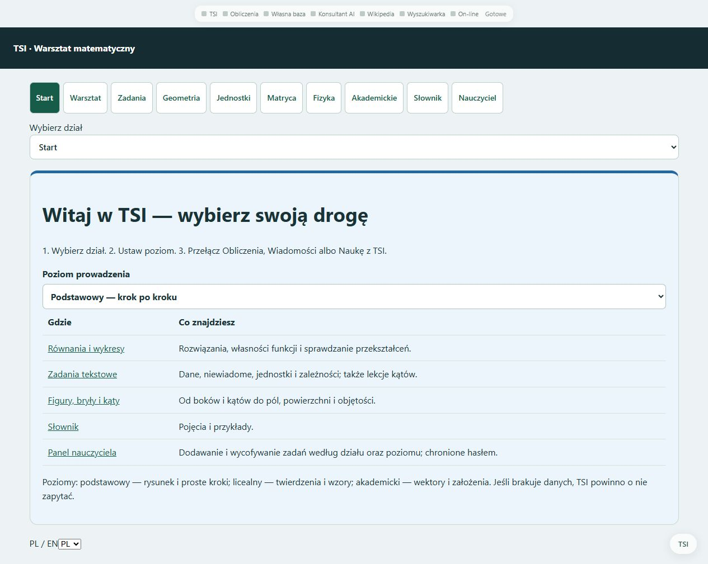
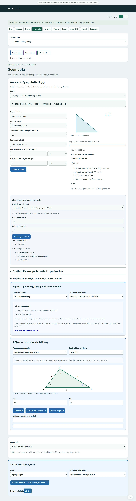

# TSI-math-validator-5

**Stan wersji lokalnej: 29 października 2026.** Lokalny warsztat matematyki: obliczenia, rysunki, sprawdzanie rozwiązań i nauka z wirtualnym asystentem TSI.

## Potwierdzony zakres aktualizacji — 29 października 2026

Pełna wersja lokalna obejmuje warsztat równań i funkcji, całki, geometrię i bryły, jednostki, logikę, audyt oraz pomocnika TSI. Geometria ma poziomy podstawowy, licealny i akademicki; dodatkowe zależności i pola formularza zależą od figury. Obliczenia sprawdzają narzędzia matematyczne. Publiczne demo z 24 października jest osobnym wydaniem bez bieżącego kodu i wag TSI.

Dzisiejszy [sprawdzian modułu sygnałowego TSI](docs/RAPORT_SYGNALY_2026-10-29.md) dotyczy kształtu próbek i temperatury maszyny. Nie jest oceną poprawności całek, równań ani pracy nauczyciela i nie podmienia modelu w walidatorze. Swobodna rozmowa TSI nie osiągnęła wymaganego poziomu. **Ta aktualizacja dokumentacji nie przebudowuje demo ani ZIP-ów.**

## Poziomy geometrii i zadania nauczyciela

W geometrii wybierz **Podstawowy**, **Licealny** lub **Akademicki**. Dodatkowe pola zależą od figury i wybranej zależności. Poziom licealny udostępnia m.in. kąty z boków, pole z kąta, wysokości ze znanego pola, przekątne i kąty przekątnych. Akademicki dodaje obliczanie pola lub objętości przez całkę dla 16 modeli figur i brył. Wynik zawiera wzór, podstawienie lub granice całkowania, wartość dokładną, przybliżenie i jednostkę.

W sekcji **Zadania od nauczyciela** przycisk prowadzi do chronionego panelu edycji. Panel pokazuje istniejące zadanie w tabeli: treść, wskazówki, odpowiedź i parametry. **Użyj jako wzoru nowego zadania** kopiuje je do formularza; dopiero **Zapisz zadanie** tworzy nowy wpis. Odnośniki pozwalają wrócić do odpowiedniego działu i otworzyć konkretne zadanie.

Te zmiany dotyczą pełnej wersji lokalnej. Opublikowane niżej demo z 24 października pozostaje osobnym wydaniem.

## Pobierz demo — Windows x64

[Pobierz paczkę ZIP](https://github.com/jbackk-lang/TSI-math-validator-5/releases/download/v2026.10.24-demo.1/TSI-Math-Validator-DEMO-Windows-x64-2026-10-24.zip) · [Wydanie i suma SHA-256](https://github.com/jbackk-lang/TSI-math-validator-5/releases/tag/v2026.10.24-demo.1)

**Rozmiar:** 17,34 MB ZIP; około 57,01 MB po rozpakowaniu (MB = 1 000 000 bajtów).

Rozpakuj **cały katalog**, uruchom **URUCHOM.bat** i pozostaw okno serwera otwarte. **ZAMKNIJ.bat** zamyka tę instancję demo. Własny Python jest dołączony; obliczenia nie wymagają instalacji, internetu ani klucza API.

**Demo:** równania i wykresy, analiza funkcji i całek, macierze, logika, audyt, jednostki, jawne modele wielkości, geometria i bryły, kąty trójkąta, podstawowe modele fizyczne oraz słownik. Obliczenia korzystają z SymPy i mpmath.

**Pełna wersja lokalna:** dodatkowo model TSI, rozmowa i kontekst, czytniki opisów, pamięć, trening, panel edycji nauczyciela i import OCR. Tych funkcji modelu i ich kodu nie publikujemy w demo. Niektóre odnośniki demo pokazują informację o funkcji pełnej wersji.

## Możliwości pełnej wersji lokalnej

| Dział | Możliwości |
|---|---|
| Start | Menu „co, gdzie i jak”; poziom podstawowy, licealny i akademicki |
| Wirtualny asystent | Wyskakujące okienko **Zapytaj TSI**; pomocnik, nauczyciel, narrator; kontekst bieżącego zadania i klikniętej wielkości |
| Figury i bryły | 19 modeli, podstawy nazw i części, obwody, pola, powierzchnie, objętości, jednostki i rysunki |
| Trójkąty i kąty | Trzeci kąt, trójkąt równoramienny, równoboczny i prostokątny, kąty zewnętrzne, cosinusy i wektory; wskazówki oraz własne odpowiedzi |
| Równania i funkcje | Rozwiązania, dziedzina, pochodne, zera, ekstrema, asymptoty i wykresy w obsługiwanym zakresie |
| Całki | Oznaczone i nieoznaczone, wykresy, pierwotna, kontrola pochodną, dziedzina, osobliwości, pole ze znakiem i geometryczne; π, e, `^` i `**` |
| Zadania tekstowe | Dane, niewiadome, zależności i rysunki dla rozpoznanych konstrukcji; lekcje kątów także na stronie zadań |
| Fizyka | Dział dostępny z każdego panelu; w menu poziomów od liceum, z wprowadzeniem do wielkości i jednostek; cztery modele mechaniki pręta |
| Pozostałe narzędzia | Macierze, logika klasyczna i T/F/U, audyt kroków, korekta wzorów z dokumentów i obrazów, mini klawiatura matematyczna |
| Nauczyciel | Bank zadań według działu i poziomu: dodawanie, edycja, wycofanie i przywracanie; razem z poprawkami i uczeniem TSI, **pod hasłem** |
| Nauka ucznia | Wspólna oprawa **Nauka · Ocena · Powtórki**, lokalna historia prób, pogrubione odpowiedzi i przekreślenie potwierdzonych błędów |

Główne menu ma wspólną kolejność i wygląd we wszystkich działach. **Jednostki** prowadzą do przelicznika i zależności wielkości; **Matryca** do rozpisywania działań. Przełączanie tematu odświeża właściwy formularz.

Przy zmianie figury etap nauki dopasowuje się do jej tematu. Kliknięcie wymiaru zawęża pomoc do tej wielkości; „Całe zadanie” przywraca pełny zakres. Zmiana danych unieważnia wcześniejsze obliczenie w kontekście asystenta.

## Jak zacząć

Uruchom lokalny panel i otwórz **`http://127.0.0.1:8795/start`**. Wybierz dział, poziom i tryb Obliczenia / Wiadomości / Nauka. Przyciskiem **Zapytaj TSI** otworzysz asystenta. **Nauczyciel** prowadzi do chronionej konsoli; używa dotychczasowego hasła panelu poprawek.

| Przykład | Wynik lub działanie |
|---|---|
| `Policz kąt trójkąta` | TSI pyta o dane |
| Następnie `40 i 60` | Trzeci kąt: **80°** |
| Prostokąt, boki 4 cm i 3 cm | Pole: **12 cm²** |
| `x^2 - 64 = 0` | **−8 i 8** |
| Całka z `x^2` od 0 do 3 | **9** |
| Kliknięcie α=40° i „Wyjaśnij” | Pomoc dotycząca wybranego kąta |

## Sprawdzenia i stan TSI

Lekcje i bank nauczyciela: **36/36** kontroli. Integracja działającej aplikacji: **20/20**. Działający wirtualny asystent i jego kontekst: **12/12**. [Dokładny zakres](docs/WIRTUALNY_ASYSTENT_I_NAUCZYCIEL_2026-10-24.md).

Wagi działającego TSI zachowano. Ostatni udokumentowany moduł dowodowy: **10 227 859 parametrów**, **41,28 MB** pliku wag — to jeden składnik aplikacji, nie całe portable. Swobodna rozmowa nie osiągnęła wymaganego poziomu. Opcjonalny dostęp przez OpenAI API jest podłączony w pełnej wersji lokalnej; wymaga własnego klucza i wybranego modelu. Połączenie z płatnym modelem nie było testowane na rzeczywistym kluczu.

Pełna wersja z modelem TSI pozostaje lokalna. Publiczne demo zawiera narzędzia matematyczne i własne środowisko uruchomieniowe, bez kodu sieci, wag i treningu TSI.

[Zakres demo i sprawdzenia](docs/DEMO_2026-10-24.md)

## Aktualny podgląd — 29 października 2026

Zrzuty przedstawiają **pełną lokalną aplikację**, a nie starszą paczkę demo z 24 października.

Geometria: poziom licealny, trójkąt 3–4–5, kąty i lekcje — rozwiń pełny zrzut

[README sprzed aktualizacji 29 października](docs/archiwum/README_przed_2026-10-29.md).
