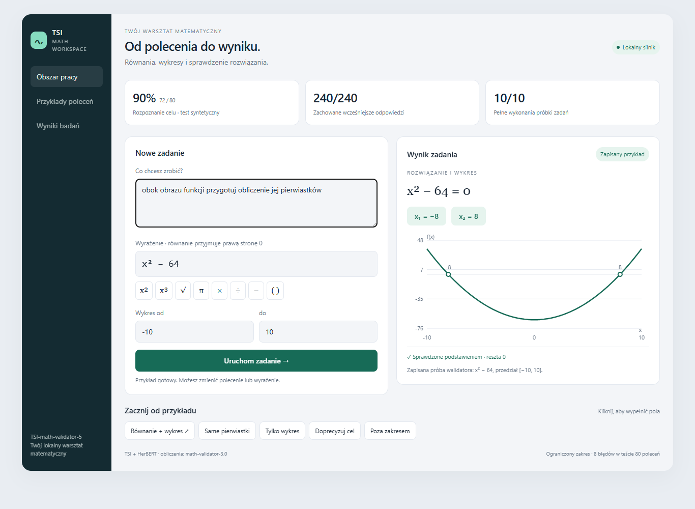

# TSI-math-validator-5

Stan dokumentacji: **16 października 2026**. Wyniki głównego eksperymentu: **15 października 2026**.

TSI jest lokalnym, eksperymentalnym systemem z uczonym rdzeniem wektorowym. Jego menedżer matematyczny rozpoznaje cel polskiego polecenia i uruchamia odpowiednie obliczenie lub wykres. Obliczenia wykonuje rzeczywisty **math-validator-3.0** oparty na SymPy; polską reprezentację językową wspiera wcześniej uczony **HerBERT**.

„5” jest nazwą tego wydania zestawu TSI i dokumentacji. Nie oznacza nowej wersji silnika SymPy ani zastąpienia użytego math-validator-3.0.

## Potwierdzony wynik

| Sprawdzenie | Wynik |
|---|---:|
| Stały test rozpoznawania pięciu celów | **72/80 — 90%** |
| Stan początkowy → obecny na tym samym teście | **68 → 71 → 72/80** |
| Utracone wcześniej poprawne odpowiedzi | **0** |
| Zachowanie wcześniejszych zadań | **240/240** |
| Pełne wykonanie stałej próbki zadań | **10/10** |
| Dodatkowe wykonanie nowo poprawionego polecenia | **1/1** |

Nowy wariant jest wybrany w lokalnej konfiguracji menedżera. Poprzedni zachowano do cofnięcia aktualizacji. Kontrola sum SHA-256 potwierdziła zachowanie 11 chronionych plików i modeli oryginalnego rdzenia. Wybrana konfiguracja nie oznacza uruchomionej usługi sieciowej ani ciągłego treningu.

## Co umie

| Cel polecenia | Zachowanie | Poprawne w teście |
|---|---|---:|
| Rozwiąż równanie | Wyznacza pierwiastki, sprawdza je podstawieniem | 15/16 |
| Rozwiąż i narysuj | Wyznacza pierwiastki i zapisuje wykres | 15/16 |
| Sam wykres | Rysuje funkcję bez uruchamiania rozwiązywania równania | 13/16 |
| Nieokreślony cel | Zgłasza potrzebę doprecyzowania | 16/16 |
| Cel poza możliwościami | Zgłasza brak obsługi tego zadania | 13/16 |

Sprawdzono rzeczywiste zadania liniowe i kwadratowe, podstawienie rozwiązań oraz wartości i pliki wykresów. Przykład: prośba „obok obrazu funkcji przygotuj obliczenie jej pierwiastków” z wyrażeniem `x**2-64` uruchamia obie czynności i daje pierwiastki −8 oraz 8.

## Jak działa i jakie przyjmuje dane

Użytkownik podaje osobno **polskie polecenie**, **wyrażenie matematyczne**, zmienną **x** i przedział wykresu. Przykładowe dane: polecenie „rozwiąż równanie i pokaż wykres”, wyrażenie `x**2-64`, przedział od −10 do 10. Przekazane wyrażenie jest traktowane jako lewa strona równania równego zeru.

Wyuczone modele oceniają cel; menedżer wybiera wykonawcę. Walidator dostarcza rozwiązania i dane wykresu, a sprawdzenie podstawienia oraz dziennik zadania dokumentują wykonanie. Brak wyrażenia lub celu powoduje żądanie uzupełnienia danych. Stan wykonania, matematyczna prawdziwość i dowód kompletności rozwiązania są rozdzielone.

Własny rdzeń TSI nadal obsługuje wcześniejsze przybliżone operacje wektorowe, pamięć i logikę trójstanową. Ich architekturę i starsze pomiary opisuje historia; nie są one nowymi wynikami testu menedżera.

## Przykłady poleceń

Wyrażenie wpisuje się w osobnym polu, a nie w zdaniu polecenia.

| Polecenie | Osobne wyrażenie | Oczekiwane działanie |
|---|---|---|
| wyznacz rozwiązania równania | `x**2-9` | Pierwiastki −3 i3 |
| obok obrazu funkcji przygotuj obliczenie jej pierwiastków | `x**2-64` | Pierwiastki −8 i8 oraz wykres |
| pokaż wykres funkcji | `x**2+1` | Sam wykres |
| pomóż mi z matematyką | dowolne dane | Prośba o doprecyzowanie celu |
| zarezerwuj bilet kolejowy | — | Zgłoszenie celu poza możliwościami |

Lokalny panel ma osobne pola polecenia, wyrażenia i przedziału. Przyciski **x², x³, √, π, ×, ÷, −, ( )** wstawiają zapis w miejscu kursora w wyrażeniu. Panel przekłada te znaki na zapis przyjmowany przez walidator; nie jest to nowa wyuczona umiejętność rozumienia dowolnej notacji. Przycisk√ wstawia `sqrt()` z kursorem wewnątrz nawiasów. Całki i pochodne pozostają poza zakresem.

Podgląd w rozmowie pokazuje interfejs i zapisane przykłady. Własne polecenia wykonuje lokalny panel po uruchomieniu silnika. Sam obraz nie jest nowym testem modelu.

## Zakres i ograniczenia

Pozostało **8 błędów na 80**.90% dotyczy całego zestawu, nie każdej klasy. Zestaw jest syntetyczny i był oceniany dla kolejnych kandydatów; nie jest nowym, jednorazowym niezależnym potwierdzeniem. Nie znaleziono jego dosłownych zdań w sprawdzonych lokalnych zbiorach uczących. Nie zbadano skuteczności na reprezentatywnej populacji rzeczywistych użytkowników.

Nie ma wydobywania wyrażenia z dowolnej wypowiedzi, ogólnego czatu ani uniwersalnego autonomicznego planera. Całki, pochodne, układy równań, publikacja i wysyłanie wyników oraz pobieranie bieżących danych są poza sprawdzonym zakresem. Rozpoznanie takiej prośby również może być błędne. Poprawne podstawienie nie dowodzi kompletności wszystkich rozwiązań. Integracje MUZ i Industrial-Predict pozostają poza tym wydaniem.

To repozytorium GitHub zawiera **wyłącznie dokumentację i podsumowanie pomiarów**. Kod, wagi i dane treningowe znajdują się w oddzielnym lokalnym repozytorium „TSI-math-validator-5”. Językowa wiedza HerBERT-a pochodzi z zewnętrznego pretrainingu, nie z samouczenia TSI od zera.

[Historia całej pracy](HISTORIA_SI_2026-10-11.md) · [Szczegółowy wynik i granice](docs/WYNIKI_2026-10-15.md) · [Pozostałe błędy](docs/POZOSTALE_BLEDY.md) · [Pochodzenie komponentów](docs/POCHODZENIE.md).
