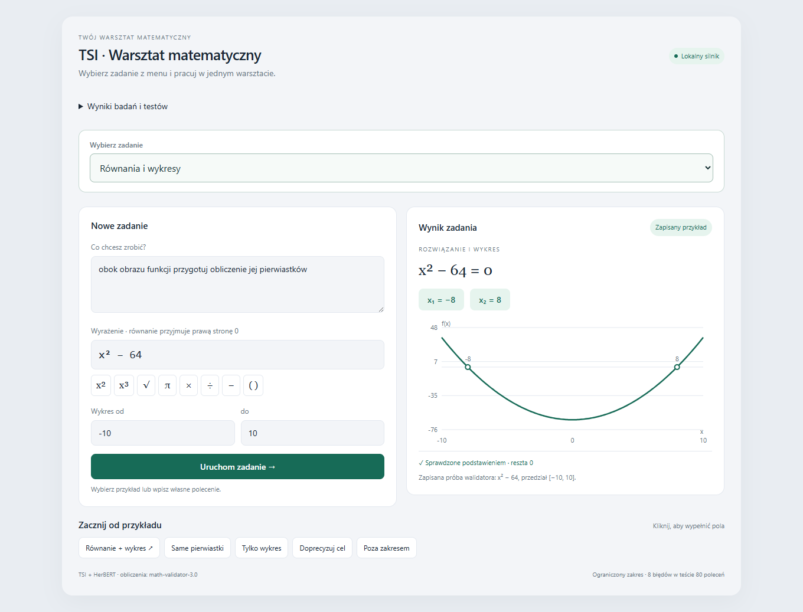
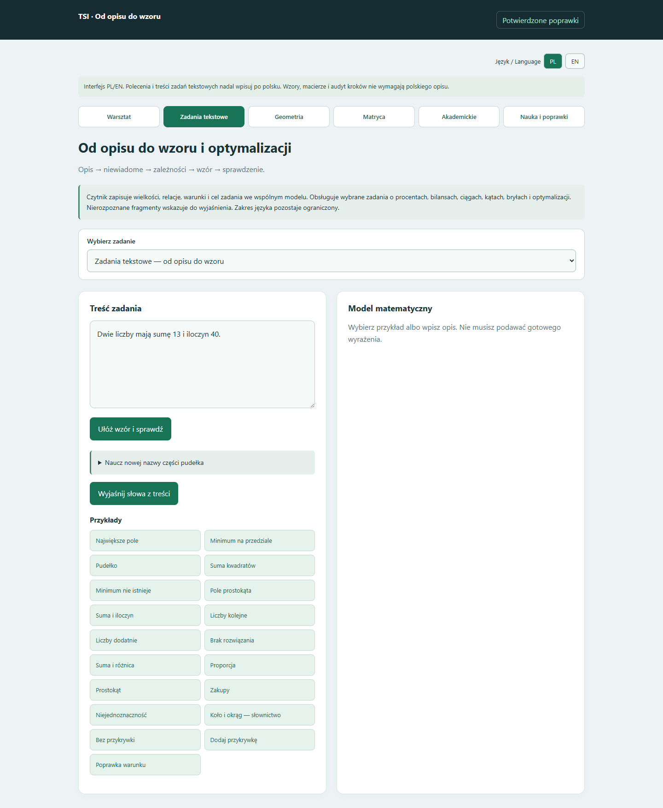
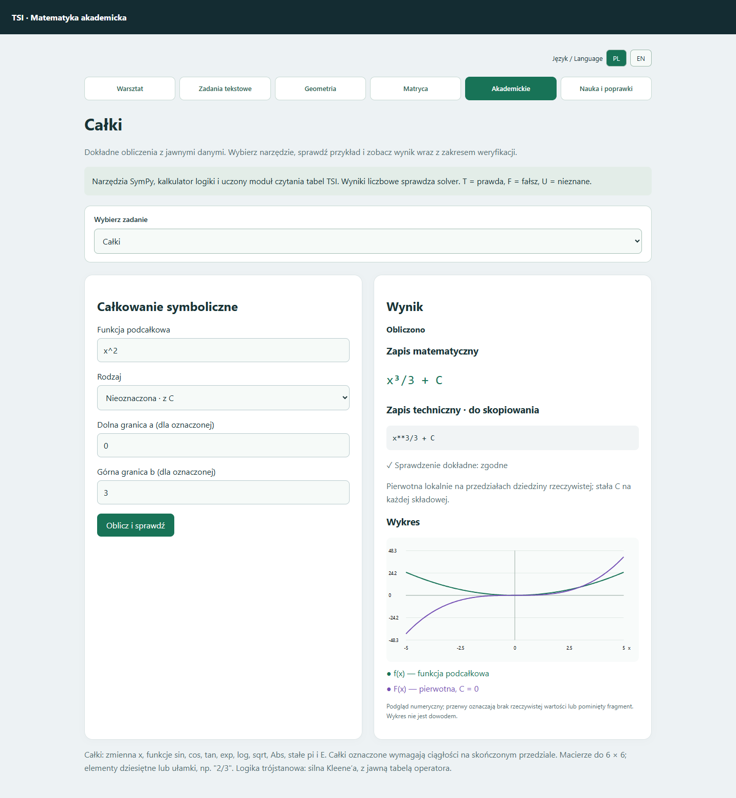

# TSI-math-validator-5

**Stan aktualny: 18 października 2026.** Lokalny warsztat matematyczny: odczytuje wybrane polecenia, buduje model zadania, oblicza wynik i pokazuje sprawdzenie. Interfejs łączy uczone czytniki TSI, kontrolowane reguły i dokładne obliczenia SymPy.

## Podgląd

Główny warsztat: wybór zadania, formularz, wynik i wykres.

Zadania tekstowe: opis, odczyt modelu i uporządkowane przykłady.

Całki: wynik i wykres funkcji oraz pierwotnej.

## Co obecnie potrafi

| Dział | Zakres |
|---|---|
| Równania i wykresy | Pierwiastki, podstawienie sprawdzające, wykres funkcji |
| Zadania tekstowe | Wybrane relacje dwóch liczb, procenty i bilanse, liczebności, ciągi z warunkami, kąty, bryły; pokazuje dane, niewiadome, relacje i cel |
| Optymalizacja | Pole prostokąta, pudełko z arkusza, suma kwadratów, funkcja kwadratowa na przedziale oraz wybrany model prostopadłościanu; dziedzina i osiągalność ekstremum |
| Geometria | Podstawowe pojęcia, części i własności figur, „każdy” / „istnieje”, negacje, kąty, obwód, pole, jednostki i podstawy trygonometrii w kontrolowanych ćwiczeniach |
| Matryce wielkości | 20 modeli, wybór niewiadomej, zgodne jednostki fizyczne i chemiczne, równania i zależności |
| Całki | Oznaczone na skończonym ciągłym przedziale i nieoznaczone ze sprawdzeniem pochodną; wykres, gdy można go wyznaczyć |
| Macierze | Do 6 × 6: działania, wyznacznik, odwrotność, rząd i układy równań |
| Logika | Klasyczna i trójstanowa Kleene’a |
| Audyt i zapis | Porównanie kolejnych równań, utracone lub dodane rozwiązania, kontrprzykłady; wskazanie miejsca błędu składni i podpowiedź |
| Raporty | JSON do ponownego przeliczenia; samodzielny HTML do wydruku; wykrywanie zmian pliku, silnika i wyniku |
| Nauka z poprawek | Bank potwierdzonych lekcji; kontrolowany trening dodatkowego czytnika działań, osobny sprawdzian i możliwość cofnięcia |

Dashboard ma przyciski do podstron, rozwijane menu zadań, wspólne tła paneli i wyrównane przykłady. Na telefonie układ przechodzi w jedną kolumnę. Zapisy `^` i `**` są obsługiwane równolegle; wyniki pokazują zapis matematyczny i techniczny. Przełącznik PL/EN obejmuje również nawigację, menu etapów i przyciski geometrii oraz matrycy. Część szczegółowych wyników i objaśnień nowych działów pozostaje po polsku. Treści zadań opisowych należy wpisywać po polsku.

## Jak korzystać

1. Uruchom panel i wybierz dział z menu albo przyciskiem podstrony.
2. Wczytaj przykład lub wpisz własne dane i kliknij przycisk obliczenia.
3. Sprawdź odczytane dane i warunki, następnie wynik. Przy prośbie o doprecyzowanie uzupełnij wskazany brak.
4. W zadaniach tekstowych i akademickich możesz zapisać raport JSON lub HTML. Wczytanie JSON pozwala ponownie obliczyć wynik lokalnie. [Obsługa i znaczenie weryfikacji](docs/RAPORTY_OBLICZEN_2026-10-17.md).

| Przykład | Oczekiwany wynik |
|---|---|
| „Dwie liczby mają sumę 13 i iloczyn 40.” | 5 i 8 |
| „Prostokąt ma obwód 40 cm. Wyznacz największe pole.” | 100 cm² |
| Całka `x^2` | `x³/3 + C` ze sprawdzeniem |
| Wyznacznik `[[1,2],[3,4]]` | −2 |
| Logika trójstanowa `F AND U` | F |

## Gdzie i kiedy działa

Aplikacja działa lokalnie na Windows przy uruchomionym serwerze: [otwórz dashboard](http://127.0.0.1:8795/). Adres jest dostępny na tym komputerze podczas pracy serwera. GitHub przechowuje dokumentację, nie uruchomioną aplikację.

| Katalog lub plik | Zawartość / uruchomienie |
|---|---|
| `TSI-math-validator-5` | Lokalne repo z kodem i modelami; `Uruchom_panel_TSI.bat` |
| `TSI-math-validator-5-Portable` | Wersja Windows x64 z kodem, modelami, Pythonem i bibliotekami; `START.bat`, zatrzymanie `ZATRZYMAJ.bat` |
| `TSI-math-validator-5-Portable-Windows-x64.zip` | Archiwum portable; rozpakuj w całości przed uruchomieniem |
| [Repozytorium GitHub](https://github.com/jbackk-lang/TSI-math-validator-5) | Dokumentacja i obrazy; bez kodu, wag i danych treningowych |

Portable nie wymaga instalowania Pythona ani pobierania modeli. Prywatny bank lekcji użytkownika nie jest dołączony. Kod źródłowy i paczka z kodem pozostają lokalnie.

## Osobny eksperyment językowy

Trenujemy również formułowanie wypowiedzi: twierdzenia, zaprzeczenia, pytania i wskazanie konkretnej brakującej wielkości. Uczona konstrukcja zdania współpracuje z jawnymi polami nazw, liczb i jednostek oraz kontrolą zachowania sensu. Eksperyment nie jest jeszcze włączony do dashboardu; nie oznacza swobodnej rozmowy ani mówienia głosem. [Aktualny zakres, wyniki i przykłady](docs/JEZYK_CZYTANIE_PISANIE_2026-10-18.md).

## Aktualna weryfikacja i ograniczenia

**1900 testów regresji przeszło** (1574 w podkatalogu testowym i 326 pozostałych). Wybrana próbka znanych zadań CKE/ZPE: **10/10**; nowe warianty tej próbki: **50/50**. To sprawdzenie określonego zakresu, nie całej matematyki.

W szerszym zestawie ZPE obejmującym 204 wpisy i warianty: **41 odpowiedzi kompletnych, 5 częściowych, 158 nierozwiązanych**. Własności figur i słowa „każdy”, „może”, „musi”: **30/30 w zestawie akceptacyjnym**. Osobny zestaw nowych sformułowań: początkowo **23/24**, po poprawce słownika **24/24**. Dwanaście kontroli brakujących lub sprzecznych danych prawidłowo zatrzymano. [Zakres i znaczenie wyników](docs/WLASNOSCI_FIGUR_2026-10-17.md).

TSI nie rozumie jeszcze dowolnego opisu. Nierozpoznany warunek, brak ilustracji lub utracony układ tabeli mogą zatrzymać zadanie. Poprawny rachunek nie gwarantuje poprawnego odczytu tekstu. Niewykonany rysunek oznacza wykonanie częściowe. Audyt obejmuje jedną zmienną i wybrane równania wymierne do stopnia 6; nie jest ogólnym narzędziem dowodzenia. Całki niewłaściwe i nieskończone granice są poza potwierdzonym zakresem.

Uczenie podczas użytkowania wymaga potwierdzonych poprawek i przejścia osobnego sprawdzianu. Nie oznacza samodzielnego opanowywania dowolnych tematów. Oryginalne modele pozostają zachowane.

[Historia projektu i wcześniejsze etapy](docs/HISTORIA_PROJEKTU.md) · [Szczegółowa diagnoza ZPE](docs/DIAGNOZA_ZPE_2026-10-17.md)
