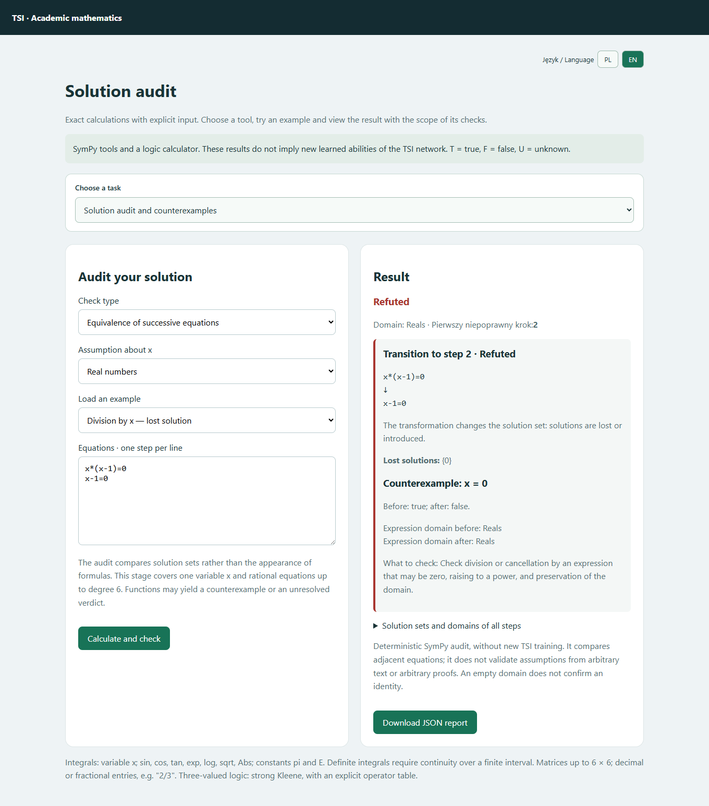
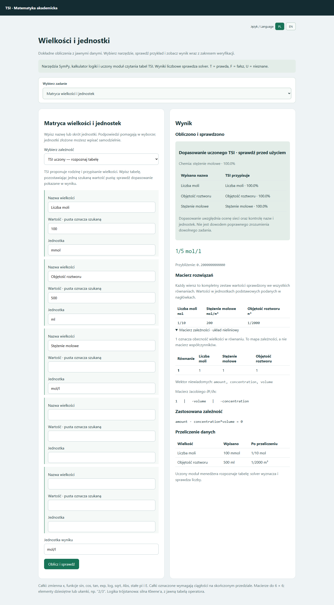
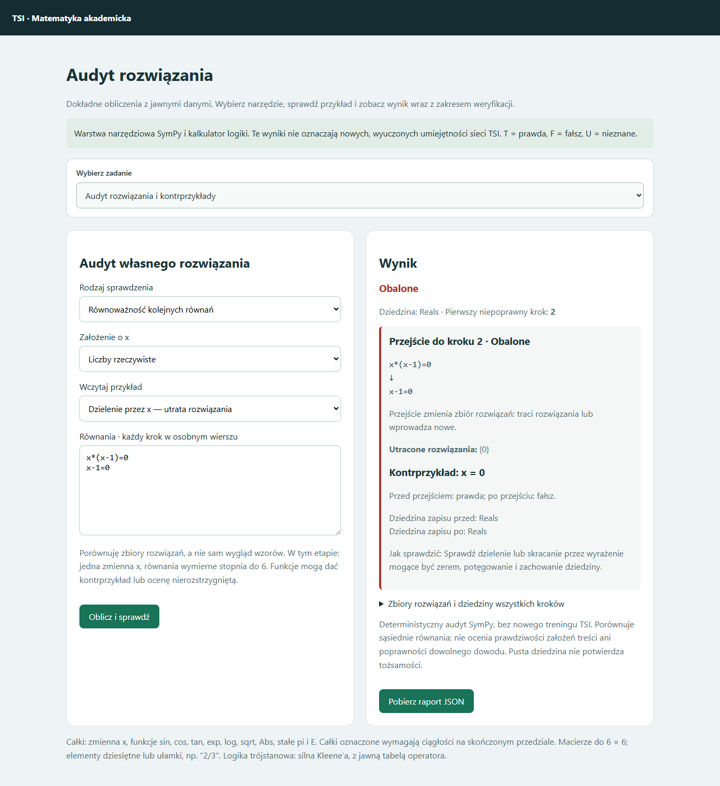
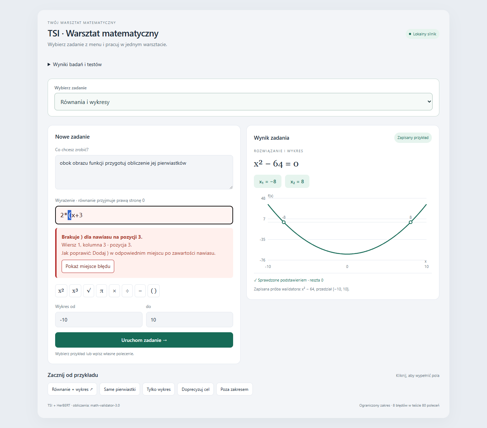
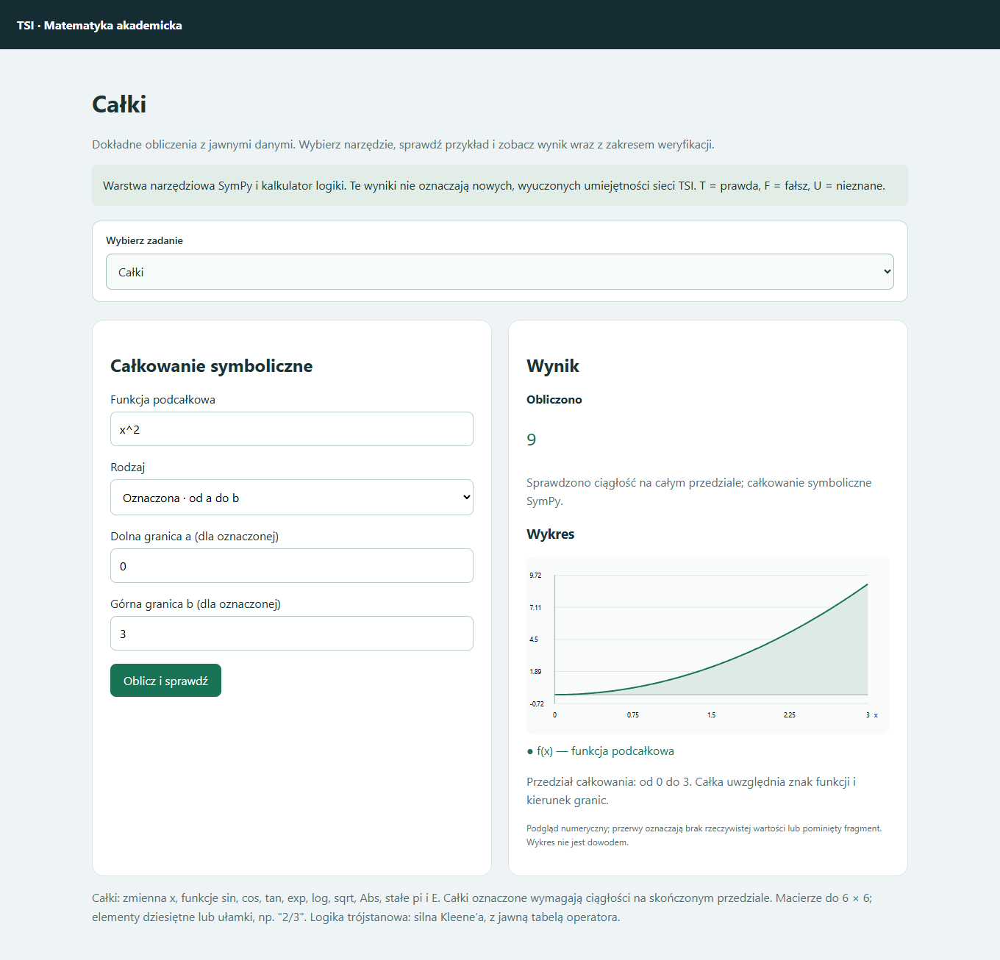

# TSI-math-validator-5

## Zweryfikowana diagnoza ZPE — 17.10.2026

**15 kompletnych odpowiedzi, cztery częściowe i 185 nierozwiązanych przypadków** w zestawie 204 wpisów. Wcześniejsze 20/204 obejmowało również niewykonane rysunki i jedną błędną interpretację tabeli; błąd został zablokowany. Pełna regresja po poprawkach: **948 testów**.

Wybrany dalszy zakres: własności figur i słowa „każdy”, „może”, „musi”. Osobny nowy sprawdzian: **2/30**, bez błędnych zaakceptowanych odpowiedzi; sześć kontroli brakujących danych zatrzymano poprawnie. To punkt odniesienia, jeszcze nie opanowany zakres. [Diagnoza, ograniczenia i następny etap](docs/DIAGNOZA_ZPE_2026-10-17.md).

## Przebudowany odczyt zadań — 17.10.2026

Wspólny model zapisuje wielkości, niewiadome, relacje, warunki i cel. Dashboard pokazuje odczyt, wynik oraz fragmenty wymagające wyjaśnienia. Nowy zakres: procenty i bilanse, liczebności klas, ciągi z warunkami, kąty trapezu, stożek oraz funkcja i optymalizacja prostopadłościanu.

**Sprawdzono: 10/10 znanych zadań CKE/ZPE, 50/50 nowych wariantów i 940 testów regresji.** Historycznie starszy zestaw ZPE zwracał 20 odpowiedzi na 204 przypadki (późniejszy audyt: 15 kompletnych, cztery częściowe i jedna błędna interpretacja tabeli) — nie deklarujemy obsługi dowolnej treści ani wszystkich arkuszy. [Przykłady, dashboard, wyniki i ograniczenia](docs/PRZEBUDOWA_CZYTNIKA_2026-10-17.md).

## Nauka z poprawek i relacje geometryczne — 17.10.2026

Dodatkowy czytnik geometrii po szkoleniu odpowiada poprawnie na 6/6 wskazanych pytań ZPE o promień, średnicę i cięciwę; świeży syntetyczny sprawdzian: 210/210. Pokazuje odczytaną relację i uzasadnienie lub kontrprzykład. Panel **Potwierdzone poprawki** obsługuje stałe zbieranie lekcji, okresowy trening opisów działań liczbowych, kontrolę poprawy i cofanie dodatkowego modelu. Uczenie geometrii nie oznacza jeszcze znajomości wszystkich figur. [Zakres, wyniki, obsługa i ograniczenia](docs/STALA_NAUKA_I_GEOMETRIA_2026-10-17.md).

## Aktualizacja odczytu zadań i audytu — 16.10.2026

Wspólny formularz obsługuje łączenie sumy, różnicy, iloczynu i ilorazu dwóch liczb, pytania o poznane pojęcia geometrii oraz wielkości geometryczne. Pokazuje odczytane relacje, założenia i konkretne brakujące dane. Audyt rozróżnia jedną tożsamość od kolejnych równań i wyjaśnia niezgodność trybu z liczbą wierszy. Sprawdzono także zadania odwrócone, rozszerzone i uproszczone. [Przykłady, testy i ograniczenia](docs/ZMIANY_ZADAN_I_AUDYT_2026-10-16.md).

Stan: **17 października 2026**. Lokalny warsztat matematyczny z uczonym menedżerem TSI oraz jawnymi narzędziami obliczeniowymi SymPy.

Publiczne repozytorium GitHub zawiera **dokumentację i zrzuty ekranu**. Kod, wagi i dane treningowe pozostają w oddzielnym repozytorium lokalnym.

## Matryca zależności i automatyczne dopasowanie

**Zwykły formularz zadań tekstowych** korzysta teraz także z matrycy: polecenie → role i dane → zależności → obliczenie → sprawdzenie. Obsługuje m.in. `pomnóż sumę 3 i 4 przez 2` oraz `dzielimy bok naprzeciw kąta przez bok przy kącie`. Brakujące wartości można uzupełnić bez opuszczania formularza.

**Automatyczna pętla** próbuje do trzech metod odczytu. Uczony czytnik ról działa automatycznie w zakresie pełnej kontrolowanej gramatyki i jawnie zdefiniowanych nazw boków; jego odpowiedź musi zgadzać się z kontrolą znaczenia. Dodatkowe słowa, sprzeczne role i brakujące dane zatrzymują obliczenie. Nowe sprawdziany integracji: 12/12 poprawnych opisów i 12/12 zatrzymanych błędnych; regresja wcześniejszych poprawnych opisów wzrosła z 12/16 do 16/16. To wynik połączenia reguł i sieci, bez zmiany głównych wag TSI. [Zakres, nauka i przykłady](docs/MATRYCA_ZALEZNOSCI_2026-10-16.md).

Osobna strona **Matryca zależności** (`/matryca`) pokazuje pełną tabelę i wyniki pośrednie. Strona **Potwierdzone poprawki** (`/lekcje`) zbiera nierozpoznane przypadki oraz poprawki użytkownika, oddzielając materiał do lekcji od odłożonego sprawdzianu. Potwierdzone lekcje mogą uruchomić kontrolowany trening dodatkowego czytnika działań liczbowych; osobny sprawdzian decyduje o jego włączeniu. Oryginalne wagi pozostają zachowane. [Kierunki i bank poprawek](docs/KOLEJNY_KROK_2026-10-16.md).

## PL / EN i portable

Przełącznik **PL / EN** zmienia interfejs, komunikaty i opisy wyników oraz zapamiętuje wybór w przeglądarce. Wpisane dane pozostają bez zmian. Polecenia i opisy zadań tekstowych nadal muszą być po polsku; wzory i audyt nie wymagają polskiej treści.

Uzupełniono tłumaczenia lekcji słów, wyników pudełka i równań oraz nowych etykiet menu. Cytowane fragmenty zadania zachowują język oryginału. Nowe osobne strony Geometria, Matryca zależności i Potwierdzone poprawki są obecnie po polsku.

Przygotowano lokalną wersję **portable Windows x64 z pełnym kodem, modelami, Pythonem i bibliotekami**. Po rozpakowaniu całości: `START.bat`; zatrzymanie: `ZATRZYMAJ.bat`. Nie wymaga instalowania Pythona ani pobierania modeli. Pakiet z kodem pozostaje lokalnie; nie jest plikiem do pobrania z tego repozytorium dokumentacyjnego. [Zakres i testy portable](docs/PL_EN_PORTABLE_2026-10-16.md).

Pakiet portable obejmuje przebudowany czytnik relacji oraz wcześniejszą geometrię, matrycę, uczone czytniki, wspólny formularz i mechanizm banku poprawek. Prywatny bank użytkownika nie jest częścią paczki. Sprawdzono działanie na dołączonym Pythonie i integralność archiwum. [Wcześniejszy opis paczki](docs/PORTABLE_AKTUALIZACJA_2026-10-16.md). Łączny sprawdzian powiązanych funkcji matematycznych: **289/289 testów**.

## Matryca wielkości, jednostki i uczony TSI

Nowy wybór **Matryca wielkości i jednostek** obejmuje 20 modeli, dowolne pole jako niewiadomą i różne zgodne jednostki. Nazwę lub skrót jednostki można wpisać z podpowiedziami, np. `centymetr`, `km/h`, `kg/m³`, `mol/l`, `g/mol`. Dostępne są jednostki SI z przedrostkami, jednostki złożone, temperatury bezwzględne i chemia: masa molowa, stężenie, rozcieńczanie, molalność. Wynik pokazuje równania, wspólne niewiadome, macierz zależności, Jacobian i macierz sprawdzonych rozwiązań.

**Wytrenowano dodatkowy czytnik tabel menedżera TSI.** W trybie „TSI uczony — rozpoznaj tabelę” rozpoznaje rodzinę i przypisuje wiersze. W trzech treningach: 396/396 odłożonych tabel dla samego czytnika (syntetyczny test nowych kombinacji znanego słownictwa). Sieć wsparta jawną kontrolą nazw i jednostek oraz dokładnym solverem: 360/360 przyjętych zadań końcowych i 60/60 dodatkowych prób nowych liczb/jednostek. Liczb nie liczy sieć; nie jest to uniwersalne rozumienie opisów. Niejasności wskazują konkretne nazwy, wartości i jednostki.

[Modele i jednostki](docs/RELACJE_JEDNOSTKI_2026-10-16.md) · [Trening, wyniki i ograniczenia](docs/UCZENIE_TABEL_TSI_2026-10-16.md).

## Nauka od podstaw

Na osobnej stronie **Geometria — nauka i ćwiczenia** (`/geometria`) są rysunki, znaczenia i sprawdzian opisów punktu, prostej, półprostej, odcinka i kąta. Wytrenowano osobny mały czytnik: 288 przykładów treningowych, 72/72 DEV i 72/72 odłożonych kombinacji znanych zwrotów. Nieznane słowa wskazuje do doprecyzowania. Dalsze ćwiczenia z dokładnym nauczycielem obejmują odległość, położenie i kąty; nie oznaczają opanowania ich przez sieć. Nowy dział jest po polsku. [Protokół, wyniki i ograniczenia](docs/PODSTAWY_GEOMETRII_2026-10-16.md).

Etap 2 — **kąt, równoległość i prostopadłość**: osobny czytnik nazw relacji na dokładnie wyznaczonych cechach geometrycznych. Po usunięciu powtórzeń: 96/96 DEV i 153/153 odłożonych danych. Jednostki i cechy oblicza narzędzie, sieć przypisuje nazwę, a nauczyciel sprawdza odpowiedź. [Wyniki, zakres i granice](docs/KATY_PROSTE_2026-10-16.md).

## Słowa i ich znaczenia

Lekcja koła i okręgu: dziewięć nowych pojęć oraz przycisk **Wyjaśnij słowa z treści**. [Zakres lekcji i ograniczenia](docs/KOLO_OKRAG_SLOWNICTWO_2026-10-16.md).

We wcześniejszej lekcji rozszerzono słownik do **39 pojęć i 189 unikatowych form po normalizacji zapisu**; kolejne działy geometrii dodają dalsze pojęcia. W zadaniach tekstowych można jawnie nauczyć nowej nazwy dna lub pokrywki. Wynik pokazuje odczytane znaczenia, negacje, poprawki i konkretne braki. „Bez przykrywki” i „nie pomijaj przykrywki” prowadzą do przeciwnych warunków. Jest to symboliczna warstwa z nadzorowanym słownikiem, bez nowego treningu wag ani uniwersalnego rozumienia języka. [Zakres, przykłady i sprawdziany](docs/SLOWA_ZNACZENIA_2026-10-16.md).

## Co robi

Wspólne rozwijane menu prowadzi do wszystkich rodzajów zadań. Formularz i wynik są obok siebie, a na telefonie jeden pod drugim. Wyniki badań są w zwijanej sekcji.

| Zadanie | Obecny zakres |
|---|---|
| Równania i wykresy | Rozpoznanie celu polskiego polecenia, osobne wyrażenie, pierwiastki i sprawdzenie podstawieniem |
| Zadania tekstowe | Siedem kontrolowanych rodzin liniowych i kwadratowych; niewiadome, równania, delta i sprawdzenie dziedziny |
| Optymalizacja | Cztery wzorce: pole prostokąta, pudełko z arkusza, suma kwadratów, funkcja kwadratowa na przedziale; pochodne, punkty stacjonarne i brzegi |
| Całki | Nieoznaczone z C i sprawdzeniem pochodną; oznaczone na ciągłym, skończonym przedziale |
| Wykresy całek | Funkcja podcałkowa; dla nieoznaczonej także pierwotna przy C=0, gdy potwierdzona; dla oznaczonej przedział i zacieniowany obszar |
| Macierze do 6 × 6 | Suma, iloczyn, transpozycja, wyznacznik, odwrotność, rząd i układy A·x=B; wykrywanie osobliwości i sprzeczności |
| Logika | Klasyczna oraz trójstanowa silna Kleene’a: NOT, AND, OR, XOR, IMPLIES, EQUIV; jawne tabele działań |
| Audyt rozwiązania | Równoważność kolejnych równań, utracone/dodane rozwiązania, pierwszy błędny krok; tożsamości i kontrprzykłady; trzy oceny i raport JSON |
| Diagnostyka zapisu | Pole i pozycja błędu, wyjaśnienie, podpowiedź i zaznaczenie w tekście; błędny wpis pozostaje do poprawy |

Czytniki opisów korzystają z reguł, wspólnego modelu relacji i wyspecjalizowanych sieci. Dokładne narzędzia obliczeniowe korzystają z SymPy. Uczony czytnik tabel jest osobnym modułem menedżera; nie zmienia wag pierwotnego rdzenia TSI. Kalkulator logiki odtwarza etykiety użyte w treningu; nie wywołuje sieci logicznej.

## Audyt własnego rozwiązania

Wybierz **Audyt rozwiązania i kontrprzykłady** i wpisz każde równanie w osobnym wierszu. Przejście `x*(x-1)=0` → `x-1=0` zostanie obalone ze wskazaniem utraconego x=0. Dla `sqrt(x^2)=x` w liczbach rzeczywistych dostaniesz kontrprzykład; przy x≥0 tożsamość zostanie potwierdzona. Można wybrać założenia i pobrać raport z wersją silnika oraz sumą źródła. Wyniki mają oceny: potwierdzone, obalone, nierozstrzygnięte.

Zakres: jedna zmienna, równania wymierne stopnia do 6 po uproszczeniu; wybrane tożsamości i próbkowane kontrprzykłady. To nie jest ogólny asystent dowodów. Brak kontrprzykładu nie dowodzi poprawności. [Zakres i przykłady audytora](docs/AUDYT_ROZUMOWANIA_2026-10-16.md).

Wyniki obliczeń wyświetlane są równolegle w zapisie matematycznym i technicznym do skopiowania, np. **x³/3 + C** i `x**3/3 + C`.

## Błąd: gdzie, co i jak poprawić

Przed obliczeniem sprawdzane są nawiasy, składnia i argumenty funkcji. Komunikat podaje wiersz, kolumnę, opis i podpowiedź. Przycisk „Pokaż miejsce błędu” zaznacza wskazany fragment. Zmiana wpisu usuwa nieaktualne wskazanie; system nie poprawia sam treści.

Przykłady: `2*(x+3` → wskazanie niezamkniętego nawiasu; `x + * 2` → błędny operator; `sin()` → brak argumentu. Dla macierzy sprawdzane są również długości wierszy, elementy, mianowniki i zgodność wymiarów. Nie każdemu błędowi matematycznemu odpowiada jeden znak: przy niezgodnych wymiarach zaznaczana jest macierz lub wiersz.

## Przykłady

| Wybór zadania | Dane | Wynik |
|---|---|---|
| Równania i wykresy | Polecenie: „rozwiąż równanie i pokaż wykres”; wyrażenie: `x^2-64` | −8 i 8, sprawdzenie oraz wykres |
| Zadania tekstowe | „Dwie liczby mają sumę 13 i iloczyn 40.” | Równanie kwadratowe, liczby 5 i 8 z zachowaniem możliwych przypisań |
| Optymalizacja | „Prostokąt ma obwód 40 cm. Wyznacz największe pole.” | Boki 10 cm, pole 100 cm² |
| Całka nieoznaczona | `x^2` | `x^3/3 + C`, sprawdzenie pochodną i dwa wykresy |
| Całka oznaczona | `x^2`, od 0 do 3 | 9 i wykres funkcji na przedziale |
| Macierze | `[[1,2],[3,4]]`, wyznacznik | −2 |
| Logika trójstanowa | `F AND U` | F; U oznacza nieznane |

Całki przyjmują zmienną x, funkcje sin, cos, tan, exp, log, sqrt, Abs i stałe pi, E. Potęgi w tym formularzu są ograniczone do liczbowych wykładników od −12 do 12. Pierwotne sprawdzane są lokalnie na składowych dziedziny. Całki niewłaściwe, nieskończone granice i niepotwierdzona ciągłość są poza tym etapem. Wykres jest przybliżonym podglądem numerycznym; zacieniowany obszar nie zastępuje całki uwzględniającej znak i kierunek granic.

## Potwierdzone wyniki i ich znaczenie

| Sprawdzenie | Wynik |
|---|---:|
| Historyczny test pięciu celów wyuczonego menedżera, 15.10.2026 | 72/80 — 90% |
| Historyczny test zachowania wcześniejszych odpowiedzi | 240/240 |
| Etap akademicki i wcześniejsze zadania, przed diagnostyką | 261/261 |
| Poprzedni zestaw regresji diagnostyki i wykresów | 62/62 |
| Obecny pełny zestaw: zadania, optymalizacja, narzędzia, diagnostyka i audyt | **326/326** |
| Testy audytora, zawarte w pełnym zestawie | 37/37 |
| Logika kalkulatora względem oryginalnych etykiet treningowych | 54/54 kombinacje |

Zestawy 261, 62 i 326 obejmują częściowo te same sprawdzenia; nie należy ich sumować. Historycznych 72/80 i 240/240 nie zmierzono ponownie w tym etapie. Sprawdzono również rzeczywiste formularze, wskazanie błędu i poprawę wpisu, wykresy, nawigację oraz widok mobilny. Kontrola SHA-256 potwierdza zachowanie 11 chronionych plików i aktywnego checkpointu.

90% dotyczy syntetycznego zestawu wyboru celów, nie dowolnych poleceń użytkowników ani całej matematyki. Parser treści ma kontrolowane wzorce; poprawny rachunek nie dowodzi poprawnej interpretacji dowolnego opisu. Sprawdzenie przez tę samą bibliotekę nie jest niezależnym dowodem kompletności rozwiązania. Ogólny czat, autonomiczny planista i pełny zakres matematyki akademickiej pozostają poza potwierdzonym zakresem.

## Uruchomienie lokalne i szczegóły

W działającej instalacji panel jest pod `http://127.0.0.1:8795/`. Ten adres działa wyłącznie na komputerze z uruchomionym serwerem; GitHub przechowuje dokumentację, nie aplikację. W modelach językowych wykorzystywany jest również wcześniej uczony HerBERT.

[Historia pracy](HISTORIA_SI_2026-10-11.md) · [Etap akademicki](docs/ETAP_AKADEMICKI_2026-10-16.md) · [Etap kwadratowy](docs/ETAP_KWADRATOWY_2026-10-16.md) · [Diagnostyka i wykresy](docs/DIAGNOSTYKA_2026-10-16.md) · [Pomiary menedżera](docs/WYNIKI_2026-10-15.md) · [Pochodzenie komponentów](docs/POCHODZENIE.md).
