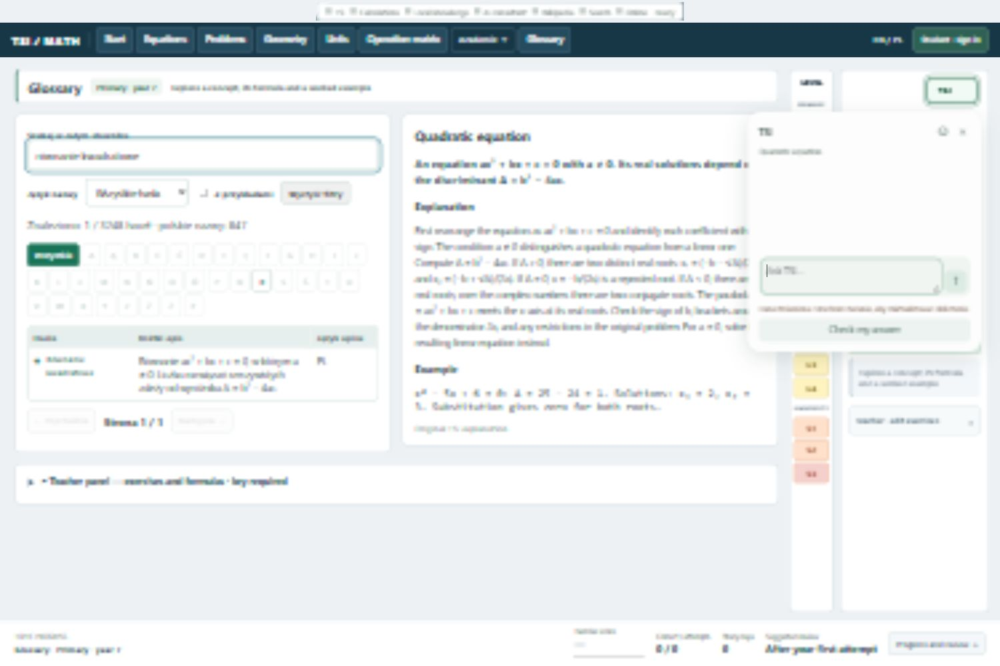

# TSI-math-validator-5

**Stan: 2 listopada 2026 — pełna wersja lokalna.** Warsztat nauki matematyki z obliczeniami, rysunkami, sprawdzaniem odpowiedzi i kontekstowym pomocnikiem TSI. Nauka jest pierwszym trybem; ustawienia i administracja są oddzielone od materiału ucznia.

## Wspólny pulpit nauki

- **Lewa kolumna:** temat, zadanie i dane. **Prawa:** wynik, wykres, rysunek, objaśnienie lub hasło słownika.
- Stałe menu działów i wyśrodkowany pasek aktywności. Fizyka została wycofana z głównego menu.
- Termometr **15 poziomów widoku:** 8 podstawowych (zielone), 4 licealne (żółte), 3 akademickie (pomarańczowe i czerwone). Narzędzia i rozszerzenia odsłaniają się stopniowo.
- Po prawej menu bieżącego tematu. Na dole tryby pracy, wyniki ocenionych prób, dni ćwiczeń i dostęp do powtórek.
- **TSI w prawym górnym rogu:** rozmowa odnosi się do działu, poziomu, zadania i wskazanego pola. Okienko rozwija się nad prawym menu.
- Interfejs **PL/EN**. W słowniku wyszukiwanie, definicja i przykład wybranego hasła korzystają z obu nazw językowych.

Poziomy są profilami stopniowania widoku; nie stanowią kompletnego programu wszystkich klas i kierunków studiów.

## Co można robić

| Dział | Zakres |
|---|---|
| Równania i funkcje | Rozwiązywanie, wykresy, dziedzina, zera, pochodne, ekstrema i asymptoty w obsługiwanym zakresie |
| Całki | Całki oznaczone i nieoznaczone, pierwotna, kontrola pochodną, granice, osobliwości, pole i wykresy; stałe π i e |
| Geometria | Figury i bryły, boki, kąty, wysokości, przekątne, obwody, pola, powierzchnie i objętości; rozszerzenia akademickie |
| Zadania tekstowe | Odczyt danych, niewiadomych, jednostek i zależności dla rozpoznanych konstrukcji; rysunki pomocnicze |
| Jednostki i matryca | Przeliczanie jednostek i modele zależności między wielkościami |
| Macierze i logika | Działania macierzowe, logika klasyczna i T/F/U, audyt kolejnych kroków rozwiązania |
| Wzory z dokumentów | Import i korekta wzoru z obsługiwanych dokumentów lub obrazów; mini klawiatura matematyczna |
| Słownik | **3248 haseł**, w tym **847 polskich nazw**; lista po lewej, wybrane objaśnienie i przykład po prawej |

Przykład wyszukiwania: **„równanie kwadratowe”**, **„rownanie kwadratowe”** lub **„quadratic equation”**. Wpis zawiera postać równania, wyróżnik, przypadki rozwiązań i przykład z podstawieniem.

## Uczeń i postęp

Każde konto ma login, nazwę, klasę i dopuszczony poziom. Nauczyciel może edytować te dane oraz blokować i ponownie aktywować konto. Wyższe poziomy są szare i udostępniają informacje o dziedzinie; zadania wymagają odblokowania przez nauczyciela.

Pierwsze logowanie rozpoczyna krótkie wprowadzenie do programu. **Zmień ucznia / klasę** umożliwia korzystanie z tego samego stanowiska na kolejnej lekcji. Wyniki i kontekst rozmowy są rozdzielone między konta.

Ocena dotyczy sprawdzonej odpowiedzi. Zapis uwzględnia poprawność i wykorzystaną pomoc TSI. Samo otwarcie strony albo pokazanie gotowego wyniku nie zwiększa liczby poprawnych prób. Poprawny, ale nieukończony krok nie jest zaliczeniem całego rozwiązania. Terminy powtórek są sugestią do pracy, nie oceną szkolną.

## Nauczyciel i bank zadań

Chroniony panel otwiera się pod obszarem pracy po podaniu klucza nauczyciela. Zawiera:

- edycję zadań, wzorów, wskazówek i wzorca odpowiedzi;
- przykładowe zadanie do użycia jako wzór;
- obrazy PNG/JPG/WebP, animacje GIF, dokumenty PDF/TXT/DOCX i krótkie filmy MP4/WebM — **do 20 MB na plik, do 6 materiałów na zadanie**;
- osobną **bazę uczniów i klas**, edytowalne uprawnienia poziomów oraz podgląd postępów;
- przypisanie banku i podglądu wyników do aktywnego działu oraz poziomu;
- **eksport i import ZIP** całego banku lub wybranego działu, razem z materiałami; import nie nadpisuje istniejących zadań i rozpoznaje ponowne wczytanie tej samej paczki.

Eksport banku nie zawiera kont, haseł, wyników uczniów, kodu ani pamięci TSI. Wycofane zadania i zablokowane konta zachowują dane.

## Sprawdzenie aktualizacji

- **6 testów integracyjnych modułu edukacyjnego — zaliczone:** rozdzielenie kont i wyników, uprawnienia, zmiana danych i poziomu, unieważnianie sesji, materiały, indywidualne wprowadzenie oraz eksport/import banku z załącznikami i kontrolą duplikatów.
- Zapisano **105 kontroli widoków poziomów**. Pełny przegląd wszystkich kombinacji działu, poziomu i języka jest kontynuowany; nie jest oznaczony jako zakończony.
- W działającym słowniku potwierdzono wynik dla równania kwadratowego, prawą kolumnę, opis PL/EN i widoczność otwartego pomocnika nad menu.

Wcześniejsze sprawdzenia obliczeń i podłączenia TSI są opisane w [archiwum poprzedniego README](docs/archiwum/README_przed_UI_20261102.md).

## Uruchomienie i wydania

Pełna aplikacja pracuje lokalnie w przeglądarce. Dostęp klasowy przez sieć i centralne zarządzanie wieloma stanowiskami są kolejnym etapem; obecne konta i klasy przygotowują dane do tego trybu.

[Publiczne demo Windows x64 — wydanie z 24 października](https://github.com/jbackk-lang/TSI-math-validator-5/releases/tag/v2026.10.24-demo.1) · [Pobierz ZIP](https://github.com/jbackk-lang/TSI-math-validator-5/releases/download/v2026.10.24-demo.1/TSI-Math-Validator-DEMO-Windows-x64-2026-10-24.zip)

Demo: **17,34 MB ZIP**, około **57,01 MB po rozpakowaniu** (MB = 1 000 000 bajtów). Rozpakuj cały katalog i uruchom **URUCHOM.bat**; **ZAMKNIJ.bat** zamyka tę instancję. Python jest dołączony. Wydanie demo jest wcześniejsze od opisanego tu nowego interfejsu i kont uczniów.

Repozytorium publiczne udostępnia dokumentację i wydane demo. **Aktualny kod, wagi i prywatna pamięć TSI pozostają lokalne.** Informacje o wspólnym TSI: [AI-SI-TSI](https://github.com/jbackk-lang/AI-SI-TSI).
