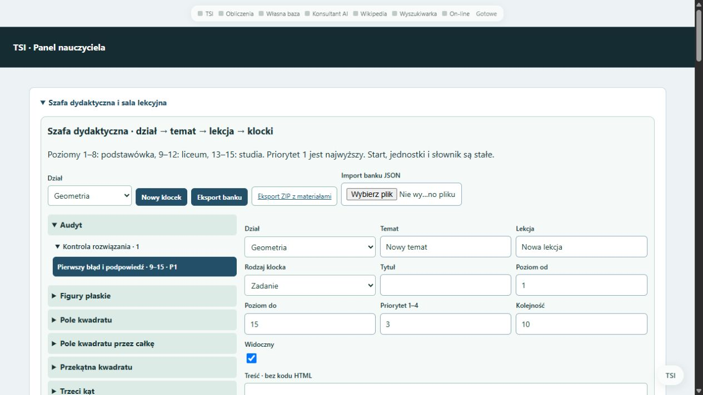
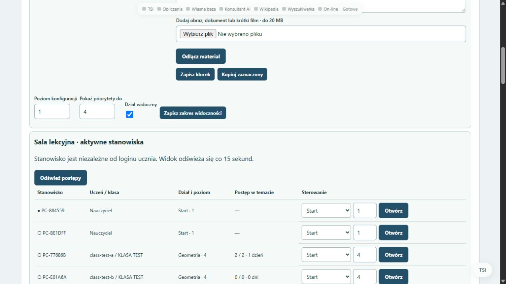

# TSI-math-validator-5

## Math Walidator w skrócie

Math Walidator to lokalny warsztat do nauki matematyki. Uczeń może obliczyć wynik, zobaczyć wykres lub rysunek i sprawdzić własne rozwiązanie. Nauczyciel może przygotować zadania i przypisać je do poziomu ucznia.

- **Równania i funkcje.** Analiza wzoru, dziedzina, miejsca zerowe i wykres. Własne przykłady można zapisywać w bibliotece.
- **Geometria.** Wprowadź współrzędne trójkąta lub wczytaj przykład. Przycisk „Analizuj krok po kroku” pokazuje obliczenia pola, obwodu, wysokości i charakterystycznych punktów. W czacie można poprawić współrzędne i porównać wyniki.
- **Analiza matematyczna.** Wybrane całki, ekstrema, szeregi potęgowe i rozwinięcia Taylora. W obsługiwanych zadaniach całkowania numerycznego TSI odróżnia szacunek błędu od gwarantowanej granicy.
- **„Zapytaj TSI”.** Pomocnik dopasowuje objaśnienie obsługiwanych zadań do poziomu podstawówki, liceum lub studiów. Przy sprawdzaniu rozwiązania wskazuje pierwszy wykryty błąd i pomaga wrócić do tego kroku.

Zakres opisuje lokalną instalację współpracującą ze wspólnym modułem TSI. W sprawdzianie etapu 118 Walidator i TSI zwróciły zgodne wyniki dla **6/6 nowych zestawów współrzędnych**. [Zakres i wyniki TSI](https://github.com/jbackk-lang/AI-SI-TSI#etap-118--podsumowanie-cyklu-geometrii-trójkąta)

## Aktualizacja 4 listopada 2026

TSI oblicza datę i godzinę przyjazdu, zachowuje kontekst po korekcie godziny i liczy dni robocze według wybranego kalendarza. W Zadaniach tekstowych → Lekcje nauczyciela są ćwiczenia ruchu na dwóch odcinkach, gęstości i przepływu z przypisaniem do poziomów.

[Uruchomienie i weryfikacja portable](docs/PORTABLE_20261104.md)


**Stan: 4 listopada 2026 — pełna wersja lokalna.** Warsztat nauki matematyki z obliczeniami, rysunkami, sprawdzaniem odpowiedzi i kontekstowym pomocnikiem TSI. Nauka jest pierwszym trybem; ustawienia i administracja są oddzielone od materiału ucznia.

## Wspólne TSI — 3 listopada 2026

Lokalne aplikacje korzystają z tej samej instalacji TSI, w wersji obsługi **`2026-11-03-consumers-11`**. Rozmowy i pamięć użytkowników są zapisywane osobno w każdej aplikacji. Zmiana panelu lub danych wybranego zadania unieważnia poprzednie aktywne dane matematyczne; przeładowanie modułu zachowuje zapisany kontekst tej samej rozmowy.

Pomocnik przelicza jednostki, sprawdza kroki równań i łączy narzędzia w zadaniach o ruchu jednostajnym. Potrafi zmienić podaną wielkość i ponownie obliczyć wynik. Audyt rozwiązania ucznia uwzględnia dane zadania oraz dziedzinę, wskazując pierwszy niezgodny wiersz. Osobno zachowano pytania o podany tekst i przyczynę opisanej czynności.

**Podłączenie: 15/15 prób w tej aplikacji; dodatkowo 7/7 przez jej działający panel HTTP.** Sprawdzono jednostki, zadanie 18 km/h przez 40 minut, zmianę czasu na 25 minut, audyt ucznia, PL/EN, kąty podawane osobno, rozdzielenie profili, zmianę kontekstu i odczyt po ponownym uruchomieniu procesu rozmowy.

Przykładowe polecenia:

```text
Przelicz 72 km/h na m/s.
Rowerzysta jedzie 18 km/h przez 40 minut. Jaką drogę pokona?
Zmień czas na 25 minut.
```

Wyniki: **20 m/s**, następnie **12 km**, po zmianie **7,5 km**. Prośbę „Sprawdź moje rozwiązanie:” można uzupełnić równaniami w kolejnych wierszach. [Szczegóły aktualizacji](docs/INTEGRACJA_TSI_20261103.md) · [Zakres wspólnego TSI](https://github.com/jbackk-lang/AI-SI-TSI).

Aktualizacja dotyczy działającej instalacji lokalnej. Wagi modułu odpowiedzi pozostają na kroku **5217**; większa sieć treningowa nie została wdrożona. [Poprzednie wydanie portable z 3 listopada](docs/PORTABLE_20261103.md). Publiczne demo pozostaje osobnym wydaniem.





## Wspólny pulpit nauki

- **Lewa kolumna:** temat, zadanie i dane. **Prawa:** wynik, wykres, rysunek, objaśnienie lub hasło słownika.
- Stałe menu działów i wyśrodkowany pasek aktywności. Fizyka została wycofana z głównego menu.
- Termometr **15 poziomów widoku:** 8 podstawowych (zielone), 4 licealne (żółte), 3 akademickie (pomarańczowe i czerwone). Narzędzia i rozszerzenia odsłaniają się stopniowo.
- Po prawej menu bieżącego tematu. Na dole tryby pracy, wyniki ocenionych prób, dni ćwiczeń i dostęp do powtórek.
- **TSI w prawym górnym rogu:** rozmowa odnosi się do działu, poziomu, zadania i wskazanego pola. Okienko rozwija się nad prawym menu.
- Interfejs **PL/EN**. W słowniku wyszukiwanie, definicja i przykład wybranego hasła korzystają z obu nazw językowych.

Poziomy są profilami stopniowania widoku; nie stanowią kompletnego programu wszystkich klas i kierunków studiów.

## Co można robić

| Dział | Zakres |
|---|---|
| Równania i funkcje | Rozwiązywanie, wykresy, dziedzina, zera, pochodne, ekstrema i asymptoty w obsługiwanym zakresie |
| Całki | Całki oznaczone i nieoznaczone, pierwotna, kontrola pochodną, granice, osobliwości, pole i wykresy; stałe π i e |
| Geometria | Figury i bryły, boki, kąty, wysokości, przekątne, obwody, pola, powierzchnie i objętości; rozszerzenia akademickie |
| Zadania tekstowe | Odczyt danych, niewiadomych, jednostek i zależności dla rozpoznanych konstrukcji; rysunki pomocnicze |
| Jednostki i matryca | Przeliczanie jednostek i modele zależności między wielkościami |
| Macierze i logika | Działania macierzowe, logika klasyczna i T/F/U, audyt kolejnych kroków rozwiązania |
| Wzory z dokumentów | Import i korekta wzoru z obsługiwanych dokumentów lub obrazów; mini klawiatura matematyczna |
| Słownik | **3248 haseł**, w tym **847 polskich nazw**; lista po lewej, wybrane objaśnienie i przykład po prawej |

Przykład wyszukiwania: **„równanie kwadratowe”**, **„rownanie kwadratowe”** lub **„quadratic equation”**. Wpis zawiera postać równania, wyróżnik, przypadki rozwiązań i przykład z podstawieniem.

## Uczeń i postęp

Każde konto ma login, nazwę, klasę i dopuszczony poziom. Nauczyciel może edytować te dane oraz blokować i ponownie aktywować konto. Wyższe poziomy są szare i udostępniają informacje o dziedzinie; zadania wymagają odblokowania przez nauczyciela.

Pierwsze logowanie rozpoczyna krótkie wprowadzenie do programu. **Zmień ucznia / klasę** umożliwia korzystanie z tego samego stanowiska na kolejnej lekcji. Wyniki i kontekst rozmowy są rozdzielone między konta.

Ocena dotyczy sprawdzonej odpowiedzi. Zapis uwzględnia poprawność i wykorzystaną pomoc TSI. Samo otwarcie strony albo pokazanie gotowego wyniku nie zwiększa liczby poprawnych prób. Poprawny, ale nieukończony krok nie jest zaliczeniem całego rozwiązania. Terminy powtórek są sugestią do pracy, nie oceną szkolną.

## Nauczyciel i bank zadań

Chroniony panel otwiera się pod obszarem pracy po podaniu klucza nauczyciela. Zawiera:

- edycję zadań, wzorów, wskazówek i wzorca odpowiedzi;
- przykładowe zadanie do użycia jako wzór;
- obrazy PNG/JPG/WebP, animacje GIF, dokumenty PDF/TXT/DOCX i krótkie filmy MP4/WebM — **do 20 MB na plik, do 6 materiałów na zadanie**;
- osobną **bazę uczniów i klas**, edytowalne uprawnienia poziomów oraz podgląd postępów;
- przypisanie banku i podglądu wyników do aktywnego działu oraz poziomu;
- **eksport i import ZIP** całego banku lub wybranego działu, razem z materiałami; import nie nadpisuje istniejących zadań i rozpoznaje ponowne wczytanie tej samej paczki.

Eksport banku nie zawiera kont, haseł, wyników uczniów, kodu ani pamięci TSI. Wycofane zadania i zablokowane konta zachowują dane.

## Klocki dydaktyczne i wspólna sala

Nowy bank układa materiał jako **dział → temat → lekcja → klocki**. Przygotowano **80 klocków z 14 istniejących przykładów i audytu dla 10 działów**. Nauczyciel edytuje treść, dodaje własny materiał, kopiuje klocek, ustawia kolejność, poziomy 1–15, priorytet i widoczność. Treść i dane zajmują lewą kolumnę, objaśnienia i ujawniane rozwiązanie prawą. Start, przelicznik jednostek i słownik pozostają stałe. Specjalistyczne formularze obliczeń nadal obsługują swoje działy; przeniesienie wszystkich dawnych treści do nowego banku nie jest jeszcze zakończone.

**Opcjonalny serwer klasy:** jeden komputer przechowuje konta, materiały i postępy, a wiele stanowisk korzysta z przeglądarki. Identyfikator stanowiska jest oddzielony od loginu i adresu IP. Nauczyciel widzi bieżący dział, poziom, poprawne odpowiedzi / ocenione próby, dni nauki i czas ostatniej oceny. Może otworzyć temat na wybranym stanowisku; limit ucznia pozostaje aktywny. Odświeżanie co 15 sekund nie przerywa edycji polecenia. To podgląd ćwiczeń, nie zabezpieczony system egzaminacyjny.

Do pracy w szkolnej sieci wymagane są **adres serwera, zaufany certyfikat HTTPS i konfiguracja dostępu przez administratora**. Tryb lokalny pozostaje domyślny. Program nie otwiera sam zapory. [Instrukcja serwera klasy](docs/SIEC_SZKOLNA.md).

Test wspólnego serwera na dwóch niezależnych klientach potwierdził osobne stanowiska i postępy, ograniczenie poziomu, uprawnienia nauczyciela i dostarczenie polecenia tylko wybranemu stanowisku. Nie przeprowadzono jeszcze odbioru na fizycznych komputerach szkolnych ani pomiaru obciążenia całej klasy.

## Sprawdzenie interfejsu z 2 listopada

- **24 testy edukacji, klocków i stanowisk — zaliczone:** rozdzielenie kont i wyników, uprawnienia, zmiana danych i poziomu, unieważnianie sesji, materiały, indywidualne wprowadzenie oraz eksport/import banku z załącznikami i kontrolą duplikatów.
- Zapisano **105 kontroli widoków poziomów**. Pełny przegląd wszystkich kombinacji działu, poziomu i języka jest kontynuowany; nie jest oznaczony jako zakończony.
- W działającym słowniku potwierdzono wynik dla równania kwadratowego, prawą kolumnę, opis PL/EN i widoczność otwartego pomocnika nad menu.

Wcześniejsze sprawdzenia obliczeń i podłączenia TSI są opisane w [archiwum poprzedniego README](docs/archiwum/README_przed_UI_20261102.md).

## Uruchomienie i wydania

Pełna aplikacja pracuje lokalnie w przeglądarce. Dostęp klasowy przez sieć i centralne zarządzanie wieloma stanowiskami są kolejnym etapem; obecne konta i klasy przygotowują dane do tego trybu.

[Publiczne demo Windows x64 — wydanie z 2 listopada](https://github.com/jbackk-lang/TSI-math-validator-5/releases/tag/v2026.11.02-demo.2) · [Pobierz ZIP](https://github.com/jbackk-lang/TSI-math-validator-5/releases/download/v2026.11.02-demo.2/TSI-Math-Validator-DEMO-Windows-x64-2026-11-02-ui2.zip)

Demo: **18.38 MB ZIP**, około **60.32 MB po rozpakowaniu** (MB = 1 000 000 bajtów). Rozpakuj cały katalog i uruchom **URUCHOM.bat**; **ZAMKNIJ.bat** zamyka tę instancję. Python jest dołączony. Demo zawiera nowy interfejs, konta uczniów i panel nauczyciela. Konta, hasła i dane tworzy użytkownik lokalnie po uruchomieniu. Sieć TSI, jej wagi, pamięć, rozmowa i trening nie są częścią paczki.

Repozytorium publiczne udostępnia dokumentację i wydane demo. **Aktualny kod, wagi i prywatna pamięć TSI pozostają lokalne.** Informacje o wspólnym TSI: [AI-SI-TSI](https://github.com/jbackk-lang/AI-SI-TSI).

[README sprzed podłączenia z 3 listopada](docs/archiwum/README_przed_integracja_20261103.md).
