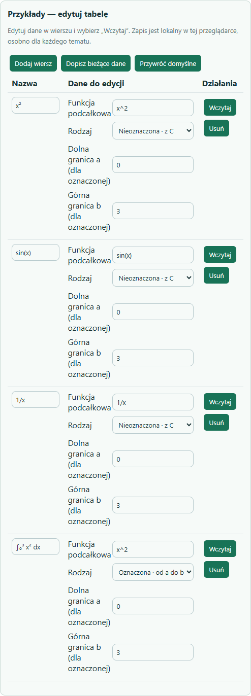
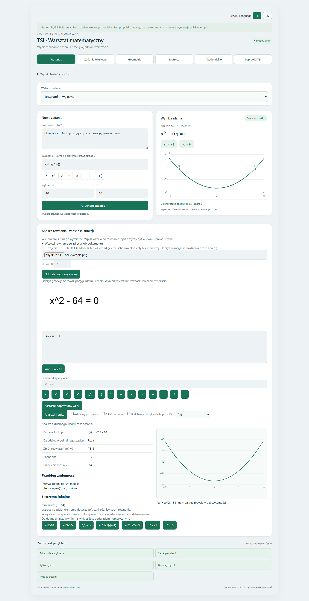
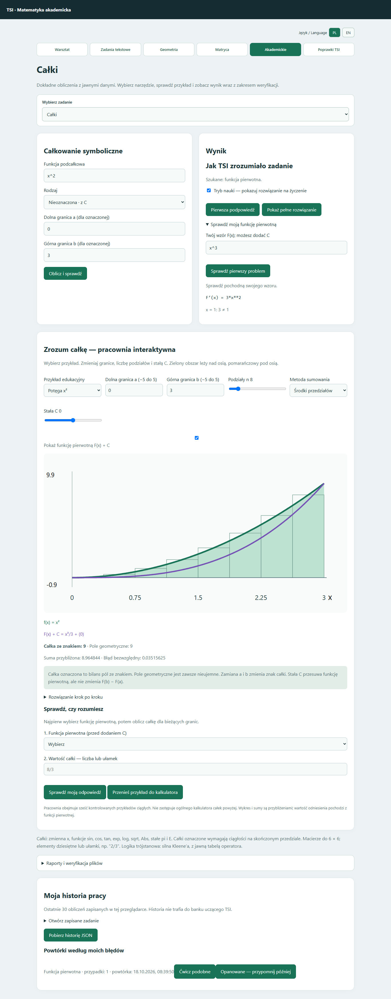
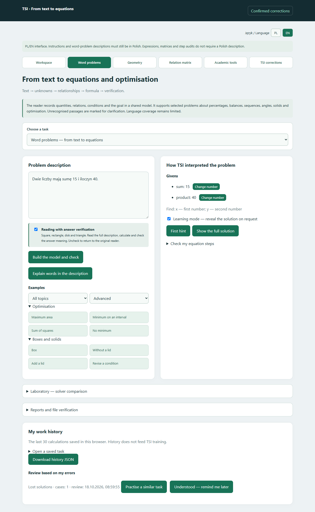

# TSI-math-validator-5

## Aktualizacja 20 października 2026 — tabele, powtórki i funkcje

**Analiza całek:** wykres funkcji podcałkowej i pierwotnej, kontrola pochodną i dziedziną, granice z `pi`, wartość ze znakiem oraz osobno pole geometryczne. Osobliwości i wykluczenia oryginalnego zapisu są wskazywane. [Obsługa, przykłady i zakres](docs/INTEGRAL_ANALYSIS_2026-10-20.md). Sprawdzenie: **9 prób obliczeń i 5 kontroli przeglądarki**.

- **Edytowalne tabele przykładów pod tematami:** nazwy i dane, dopisywanie własnych zadań, wczytywanie, usuwanie oraz przywracanie domyślnych. Zapis osobno dla każdego tematu w tej przeglądarce; PL/EN.
- **Powtórki z błędów:** po wykryciu utraty lub dodania rozwiązania panel proponuje warianty z innymi liczbami, sprawdza odpowiedź i zapisuje postęp. Dwie kolejne poprawne pierwsze odpowiedzi na różnych wariantach przesuwają powtórkę o dobę.
- **Szersza analiza funkcji:** `sqrt`, `log`, `exp`, `sin`, `cos`, `tan`, granice i klikane przedziały znaku. Dla funkcji elementarnych przebieg zmienności i znak są analizowane w wybranym oknie, z kontrolą dziedziny. Trygonometria: argument `a*x+b`, kąty w radianach.

[Instrukcja, zakres i wyniki weryfikacji](docs/TABLES_PRACTICE_FUNCTIONS_2026-10-20.md). Nowe kontrole: tabele tematów **18/18**, powtórki **5/5**, przypadki funkcji **8/8**, znak i ograniczenia **5/5**, obsługa funkcji w przeglądarce **6/6**; wcześniejsza analiza **27/27**. Paczka portable nie zawiera jeszcze tej partii.

## Aktualizacja 19 października 2026 — równania, wykresy i import

**Działa lokalnie w warsztacie:** analiza wielomianów i funkcji wymiernych, dziedzina z wykluczeniami, zera, pochodna, wzrost i spadek, ekstrema, asymptoty i dziury w wykresie. Wykres obu stron równania, opcjonalna pochodna oraz aktualizacja po zmianie wzoru.

**Opis połączony z wykresem:** klikane miejsca zerowe, ekstrema, przedziały i asymptoty. **Sprawdzanie własnych kroków:** ocena od aktualnego równania, pierwszy problem, podpowiedź i osobno świadek utraty lub dodania rozwiązań; PL/EN. Dodatkowe testy przeglądarki: **10/10**.

**Zdjęcie lub dokument → korekta → analiza:** import PDF z wyborem strony, TXT/MD, DOCX i zdjęć; wklejanie zdjęcia ze schowka. Edytowalny odczyt, osobne pole korekty i mini klawiatura matematyczna. OCR działa lokalnie i wymaga sprawdzenia znaków przed analizą.

**Aktualny TSI z 19 października:** wyuczony czytnik operacji i argumentów oraz matryce językowe. Opcjonalny moduł TSI opisuje kształt próbek funkcji. Dokładne własności nadal wyznaczają solvery.

[Instrukcja, zakres, wyniki testów i ograniczenia](docs/EQUATION_ANALYSIS_2026-10-19.md). Zestawy sprawdzeń: analiza **27/27**, czytnik **42/42**, import **8/8**, przeglądarka **10/10** i import z korektą **6/6**. Portable z wcześniejszej partii nie zawiera jeszcze tej aktualizacji.

## Aktualizacja 18 października 2026 — czytnik ogólnej TSI

W zadaniach tekstowych działa nowa warstwa TSI: polecenia działań PL/EN, role liczb, kolejność kroków i odczyt źródła z pytaniem. Wspólne wagi H512 zachowano; dotychczasowe solvery i wykresy pozostają aktywne. [Zakres, przykłady i testy podmiany](docs/UNIVERSAL_TSI_READER_2026-10-18.md).

## Aktualizacja 18.10.2026 — nauka i historia pracy

Panel pokazuje rozpoznane dane i szukane, oferuje stopniowane podpowiedzi i sprawdzanie własnych kroków. Historia lokalna odtwarza dane i rysunki, a wykryte błędy tworzą listę powtórek. Przykłady mają grupy i filtr trudności; ustawienia zaawansowane są zwijane. [Obsługa i zakres](docs/WARSZTAT_NAUKI_2026-10-18.md).

**Stan aktualny: 20 października 2026.** Lokalny warsztat matematyczny: odczytuje wybrane polecenia, buduje model zadania, oblicza wynik i pokazuje sprawdzenie. Interfejs łączy uczone czytniki TSI, kontrolowane reguły i dokładne obliczenia SymPy.

### Najnowsze funkcje

- **Warsztat nauki:** rozpoznane dane i szukane, zmiana pojedynczej liczby, trzy podpowiedzi i rozwiązanie na życzenie. Kontrola własnych przekształceń wskazuje pierwszy problem; kontrola funkcji pierwotnej obejmuje również dziedzinę.
- **Historia i powtórki:** do 30 obliczeń w przeglądarce, odtwarzanie rysunków, ponowne wczytanie danych i eksport JSON. Lista powtórek wynika z błędów własnego rozwiązania.
- **Całki edukacyjne:** sześć interaktywnych przykładów, sumy przybliżone, pole ze znakiem i geometryczne, przesuwanie stałej C oraz ćwiczenia. [Opis](docs/NAUKA_CALEK_2026-10-18.md).
- **Rysunki:** wspólne generowanie ilustracji z rozpoznanych danych i podgląd figury ze współrzędnych. [Zakres](docs/AUTOMATYCZNE_RYSUNKI_2026-10-18.md).
- **Bank poprawek:** panel z hasłem, wycofanie błędnej lekcji, reset i przywrócenie kopii. [Obsługa](docs/BANK_POPRAWEK_I_HASLO_2026-10-18.md).
- **Laboratorium VQLS:** lokalny prototyp porównania solverów na symulatorze; bez użycia QPU. [Warunki i wyniki](docs/VQLS_PROTOTYP_2026-10-18.md).

Najnowszy zestaw regresji warsztatu: **89/89 testów**. Dodatkowo sprawdzono w przeglądarce podpowiedzi, zmianę liczby, pierwszy błędny krok, funkcję pierwotną, historię z rysunkiem, filtry i przełącznik PL/EN. Wynik dotyczy tego zakresu, nie dowolnych zadań.

## Podgląd

Główny warsztat: wybór zadania, formularz, wynik i wykres.

Zadania tekstowe: opis, odczyt modelu i uporządkowane przykłady.

Całki: wynik i wykres funkcji oraz pierwotnej.

## Co obecnie potrafi

| Dział | Zakres |
|---|---|
| Równania i wykresy | Pierwiastki, podstawienie sprawdzające, wykres funkcji |
| Zadania tekstowe | Wybrane relacje dwóch liczb, procenty i bilanse, liczebności, ciągi z warunkami, kąty, bryły; pokazuje dane, niewiadome, relacje i cel |
| Optymalizacja | Pole prostokąta, pudełko z arkusza, suma kwadratów, funkcja kwadratowa na przedziale oraz wybrany model prostopadłościanu; dziedzina i osiągalność ekstremum |
| Geometria | Podstawowe pojęcia, części i własności figur, „każdy” / „istnieje”, negacje, kąty, obwód, pole, jednostki i podstawy trygonometrii w kontrolowanych ćwiczeniach |
| Matryce wielkości | 20 modeli, wybór niewiadomej, zgodne jednostki fizyczne i chemiczne, równania i zależności |
| Całki | Oznaczone na skończonym ciągłym przedziale i nieoznaczone ze sprawdzeniem pochodną; wykres, gdy można go wyznaczyć |
| Macierze | Do 6 × 6: działania, wyznacznik, odwrotność, rząd i układy równań |
| Logika | Klasyczna i trójstanowa Kleene’a |
| Audyt i zapis | Porównanie kolejnych równań, utracone lub dodane rozwiązania, kontrprzykłady; wskazanie miejsca błędu składni i podpowiedź |
| Raporty | JSON do ponownego przeliczenia; samodzielny HTML do wydruku; wykrywanie zmian pliku, silnika i wyniku |
| Nauka z poprawek | Bank potwierdzonych lekcji; kontrolowany trening dodatkowego czytnika działań, osobny sprawdzian i możliwość cofnięcia |

Dashboard ma przyciski do podstron, rozwijane menu zadań, wspólne tła paneli i wyrównane przykłady. Na telefonie układ przechodzi w jedną kolumnę. Zapisy `^` i `**` są obsługiwane równolegle; wyniki pokazują zapis matematyczny i techniczny. Przełącznik PL/EN obejmuje również nawigację, menu etapów i przyciski geometrii oraz matrycy. Część szczegółowych wyników i objaśnień nowych działów pozostaje po polsku. Treści zadań opisowych należy wpisywać po polsku.

## Jak korzystać

1. Uruchom panel i wybierz dział z menu albo przyciskiem podstrony.
2. Wczytaj przykład lub wpisz własne dane i kliknij przycisk obliczenia.
3. Sprawdź odczytane dane i warunki, następnie wynik. Przy prośbie o doprecyzowanie uzupełnij wskazany brak.
4. W zadaniach tekstowych i akademickich możesz zapisać raport JSON lub HTML. Wczytanie JSON pozwala ponownie obliczyć wynik lokalnie. [Obsługa i znaczenie weryfikacji](docs/RAPORTY_OBLICZEN_2026-10-17.md).

| Przykład | Oczekiwany wynik |
|---|---|
| „Dwie liczby mają sumę 13 i iloczyn 40.” | 5 i 8 |
| „Prostokąt ma obwód 40 cm. Wyznacz największe pole.” | 100 cm² |
| Całka `x^2` | `x³/3 + C` ze sprawdzeniem |
| Wyznacznik `[[1,2],[3,4]]` | −2 |
| Logika trójstanowa `F AND U` | F |

## Gdzie i kiedy działa

Aplikacja działa lokalnie na Windows przy uruchomionym serwerze: [otwórz dashboard](http://127.0.0.1:8795/). Adres jest dostępny na tym komputerze podczas pracy serwera. GitHub przechowuje dokumentację, nie uruchomioną aplikację.

| Katalog lub plik | Zawartość / uruchomienie |
|---|---|
| `TSI-math-validator-5` | Lokalne repo z kodem i modelami; `Uruchom_panel_TSI.bat` |
| `TSI-math-validator-5-Portable` | Wersja Windows x64 z kodem, modelami, Pythonem i bibliotekami; `START.bat`, zatrzymanie `ZATRZYMAJ.bat` |
| `TSI-math-validator-5-Portable-Windows-x64.zip` | Archiwum portable; rozpakuj w całości przed uruchomieniem |
| [Repozytorium GitHub](https://github.com/jbackk-lang/TSI-math-validator-5) | Dokumentacja i obrazy; bez kodu, wag i danych treningowych |

Portable nie wymaga instalowania Pythona ani pobierania modeli. Prywatny bank lekcji użytkownika nie jest dołączony. Kod źródłowy i paczka z kodem pozostają lokalnie.

## Aktywny rdzeń i pamięć

Właściwy rdzeń TSI został poszerzony **H256 → H512**: z **784 338 do 2 168 274 parametrów** wraz ze współdzieloną pamięcią i logiką. Transfer zachował wyniki wcześniejszych prób PL/EN i wektorowych; nie oznacza automatycznego zdobycia nowych umiejętności. Osobny większy moduł językowy formułuje odpowiedzi w kontrolowanym zakresie.

Trwała lokalna pamięć przywołuje zatwierdzone poprawki po ponownym uruchomieniu, przelicza wynik i zatrzymuje sprzeczne wpisy. Błędów nie uznaje automatycznie za wiedzę, a sprawdziany pozostają wyłączone z podpowiedzi. Nowy odczyt działa w istniejących Zadaniach tekstowych; strona Poprawki TSI służy zatwierdzaniu poprawek programu. [Stan, testy i ograniczenia](docs/RDZEN_I_PAMIEC_2026-10-18.md).

## Aktualna weryfikacja i ograniczenia

**1984 różne testy przeszły.** Pełna regresja po wymianie rdzenia: 1982/1982; dwa dodatkowe testy raportów oraz powtórzone testy raportów: 22/22. Wybrana próbka znanych zadań CKE/ZPE: **10/10**; nowe warianty tej próbki: **50/50**. To sprawdzenie określonego zakresu, nie całej matematyki.

W szerszym zestawie ZPE obejmującym 204 wpisy i warianty: **41 odpowiedzi kompletnych, 5 częściowych, 158 nierozwiązanych**. Własności figur i słowa „każdy”, „może”, „musi”: **30/30 w zestawie akceptacyjnym**. Osobny zestaw nowych sformułowań: początkowo **23/24**, po poprawce słownika **24/24**. Dwanaście kontroli brakujących lub sprzecznych danych prawidłowo zatrzymano. [Zakres i znaczenie wyników](docs/WLASNOSCI_FIGUR_2026-10-17.md).

TSI nie rozumie jeszcze dowolnego opisu. Nierozpoznany warunek, brak ilustracji lub utracony układ tabeli mogą zatrzymać zadanie. Poprawny rachunek nie gwarantuje poprawnego odczytu tekstu. Niewykonany rysunek oznacza wykonanie częściowe. Audyt obejmuje jedną zmienną i wybrane równania wymierne do stopnia 6; nie jest ogólnym narzędziem dowodzenia. Całki niewłaściwe i nieskończone granice są poza potwierdzonym zakresem.

Uczenie podczas użytkowania wymaga potwierdzonych poprawek i przejścia osobnego sprawdzianu. Nie oznacza samodzielnego opanowywania dowolnych tematów. Oryginalne modele pozostają zachowane.

[Historia projektu i wcześniejsze etapy](docs/HISTORIA_PROJEKTU.md) · [Szczegółowa diagnoza ZPE](docs/DIAGNOZA_ZPE_2026-10-17.md)

### Rysunki do zadań

Automatyczne osie liczbowe, schematy figur i pudełek, kolejność działań oraz wykresy funkcji celu na podstawie rozpoznanych danych. [Zakres i ograniczenia](docs/AUTOMATYCZNE_RYSUNKI_2026-10-18.md).

### Nauka całek

Interaktywne pole pod wykresem, sumy prostokątów i trapezów, funkcja pierwotna ze stałą C oraz ćwiczenia z informacją o błędnym kroku. [Zakres pracowni](docs/NAUKA_CALEK_2026-10-18.md).

### Układy liniowe i VQLS — prototyp lokalny

Porównanie dokładnego solvera z idealną symulacją VQLS dla układów 1–4 niewiadomych. Wykrywanie nieliniowości, kontrola uwarunkowania i sprawdzenie w pierwotnych równaniach. Bez QPU i bez deklaracji przewagi kwantowej. [Zakres, wynik i ograniczenia](docs/VQLS_PROTOTYP_2026-10-18.md).

### Kontrola poprawek

Bank poprawek chroniony hasłem: wycofanie pojedynczej lekcji, reset z kopią i przywracanie kopii. [Obsługa i zakres](docs/BANK_POPRAWEK_I_HASLO_2026-10-18.md). W Geometrii, etap 5, rysunek odświeża się wraz ze współrzędnymi.

## Warsztat — podgląd przykładów i szybkość, 18 października 2026

Kliknięcie przykładu od razu pokazuje jego cel i równanie, zaznacza wybrany przycisk oraz usuwa wynik poprzedniego zadania. Wynik i wykres pojawiają się po obliczeniu. Podczas trwającego obliczenia wybór przykładu jest zablokowany, aby poprzedni wynik nie nadpisał nowego wyboru. Komunikaty podglądu działają PL/EN.

Dla jawnych obsługiwanych poleceń i wielomianów stopnia do 6 dodano ścieżkę korzystającą bezpośrednio z istniejącego solvera i danych wykresu. Nie uruchamia ona ciężkiego wyboru narzędzia ani nie zapisuje zbędnego PNG dla wykresu rysowanego przez dashboard. Zmieniony wzór jest rzeczywiście przeliczany; nie używa zapisanej odpowiedzi przykładu. Pozostałe polecenia zachowują dotychczasową ścieżkę. Mianowniki zawierające x i inne konstrukcje wymagające szerszej kontroli dziedziny nie są przejmowane przez tę optymalizację.

Pomiar HTTP dla x²−64: przed zmianą 5.527 s; pierwsze obliczenie po ponownym uruchomieniu 2.539 s. Trzy kolejne sprawdzone zadania: 0.008–0.018 s. Są to pojedyncze pomiary lokalne, nie gwarancja czasu dla dowolnego zadania.

Weryfikacja: 19/19 testów szybkiej ścieżki; cztery poprawne odpowiedzi HTTP (równanie z wykresem, same pierwiastki, sam wykres, zmienione równanie x²−81). Sprawdzono też w przeglądarce natychmiastową zmianę opisu bez uruchamiania analizy i rzeczywiste obliczenie pierwiastków −8 i 8 z wykresem.
