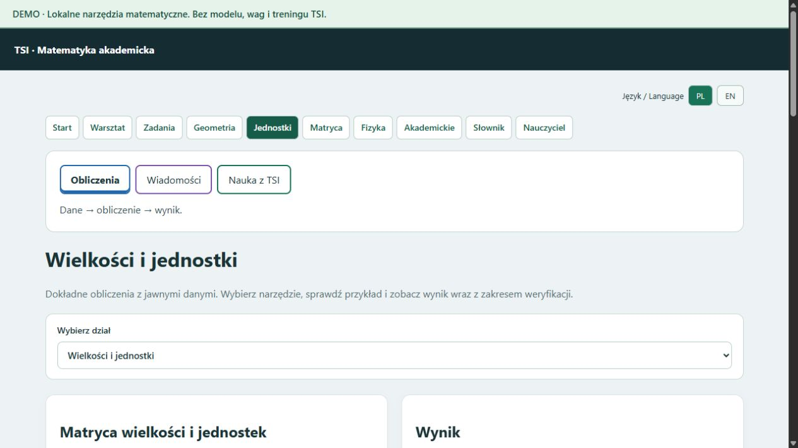

# Demo — 24 października 2026

Publiczne wydanie Windows x64: [pobranie i SHA-256](https://github.com/jbackk-lang/TSI-math-validator-5/releases/tag/v2026.10.24-demo.1).

ZIP: **17 335 569 bajtów / 17,34 MB**. Po rozpakowaniu około **57,01 MB**. Własny Python 3.12.10, SymPy 1.14.0, mpmath 1.3.0. Start: `URUCHOM.bat`; zamknięcie tej instancji: `ZAMKNIJ.bat`.

Wydanie nie zawiera kodu sieci TSI, wag, pamięci, treningu, kluczy API ani dokumentów użytkownika. Rozmowa i automatyczny odczyt opisów, edytor nauczyciela i OCR wymagają pełnej wersji lokalnej; odnośnik może wskazywać tę informację.

Sprawdzenia: osiem obliczeń we własnym środowisku paczki — całka x², wyznacznik macierzy, AND(T,U), 36 km/h na m/s, x²−64, trzeci kąt trójkąta, katalog brył i odległość punktów (0,0), (3,4). Importy torch oraz tsi_shared niedostępne. Dodatkowo przelicznik sprawdzono w działającym interfejsie: **36 km/h = 10 m/s**.

Ujednolicono menu we wszystkich głównych działach. Naprawiono pomylenie odnośnika „Jednostki” z „Matrycą działań”, przełączanie formularza przy zmianie tematu oraz przypisanie jednostek i logiki do banku ćwiczeń. Opis zakresu obliczeń odpowiada wybranemu tematowi.

