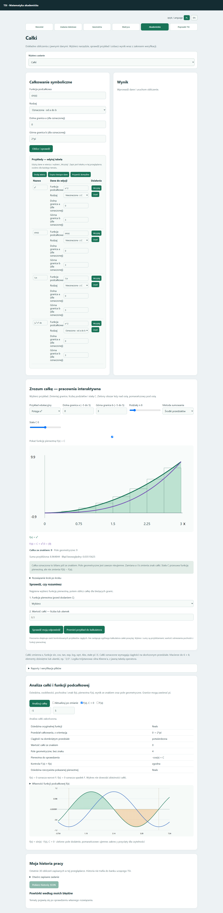

# Analiza całek — 20 października 2026

W dziale **Całki**, poniżej formularza, działa **Analiza całki i funkcji podcałkowej**. Ustaw funkcję oraz rodzaj całki, po czym wybierz **Analizuj całkę**. Opcjonalna aktualizacja po zmianie przelicza aktualne dane. Dla całki nieoznaczonej można ustawić okno wykresu; dla oznaczonej jest ono dobierane do granic. Obsługa PL/EN.

## Co pokazuje

- Dziedzinę oryginalnej funkcji, miejsca wykluczone, pochodną, monotoniczność i znak f(x), zgodnie z zakresem analizy funkcji.
- Pierwotną F(x) oraz kontrolę przez różniczkowanie F′(x)=f(x). Osobno pokazuje rzeczywistą dziedzinę podanego wzoru pierwotnej. Jeśli wzór nie obejmuje całej dziedziny funkcji, wskazuje potrzebę osobnych gałęzi i stałych całkowania.
- Dla całki oznaczonej: orientację granic, potwierdzenie ciągłości, wartość ze znakiem i osobno pole geometryczne, gdy zostało wyznaczone.
- Wykres f(x), opcjonalnie F(x) dla C=0 i pochodnej f′(x). Na prawidłowym przedziale obszar dodatni jest zielony, ujemny pomarańczowy. Granice zaznaczono liniami.

Granice mogą zawierać stałe, np. `pi` i `2*pi`. Znak f wskazuje kierunek zmian pierwotnej: f>0 oznacza wzrost F, a f<0 spadek F. Zmiana danych usuwa poprzedni wynik i wykres.

## Przykłady

| Funkcja i granice | Wartość całki | Pole geometryczne |
|---|---:|---:|
| x², od 0 do 3 | 9 | 9 |
| sin(x), od 0 do 2*pi | 0 | 4 |
| x², od 3 do 0 | −9 | 9 |
| sqrt(x), od 0 do 4 | 16/3 | 16/3 |

Pole nie jest liczone jako wartość bezwzględna całego wyniku. Przedział dzielony jest w potwierdzonych miejscach zerowych, a moduły całek składowych sumowane. Brak potwierdzenia pełnego podziału jest zgłaszany.

## Kontrola dziedziny i ograniczenia

W tej partii obliczenia oznaczone wymagają ciągłości na całym skończonym, domkniętym przedziale w dziedzinie oryginalnego zapisu. Przejście przez osobliwość albo wykluczony argument wymaga osobnej analizy całki niewłaściwej. Panel nie nazywa automatycznie każdego takiego przypadku rozbieżnym i nie podstawia wartości głównej Cauchy’ego.

Dotyczy to również `x/x` przez zero i skróconych ułamków, np. `(x²-1)/(x-1)` przez x=1. Skrócenie nie przywraca wykluczonego argumentu. Ten sam warunek dodano do dotychczasowego przycisku obliczania całek.

Przykładowo dla 1/x pierwotna zapisana jako log(x) nie jest rzeczywistym wzorem na ujemnej składowej dziedziny. Panel pokazuje tę różnicę, zamiast sugerować pełne pokrycie całej osi.

Obowiązują ograniczenia dziedziczone z analizy funkcji: wybrane funkcje jednej zmiennej, ograniczone okno dla funkcji elementarnych, kontrolowane argumenty trygonometrii. Widok pola jest podglądem numerycznym; nie dowodzi zbieżności. Paczka portable nie została przebudowana w tej partii.

## Sprawdzenie

9 prób obliczeń i dziedziny: x², sin(x), odwrotne granice, sqrt(x), x/x przez zero, 1/x przez zero, skrócony ułamek, redukcja sqrt(x)-sqrt(x)+1 oraz rzeczywista dziedzina pierwotnej 1/x.

5 kontroli przeglądarki: wynik, pole i pierwotna na wykresie; usuwanie starego wykresu; brak pola przy niepotwierdzonej całce przez osobliwość; angielski; ukrywanie analizy po zmianie działu.

