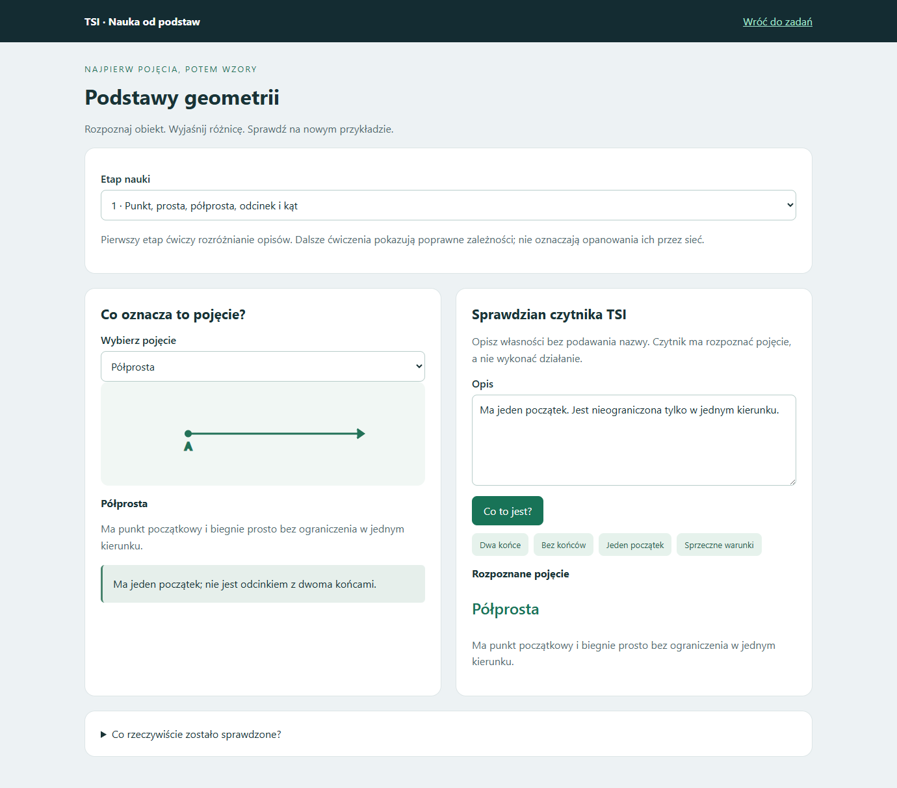

# Podstawy przed geometrią zaawansowaną — 16.10.2026

Aktualizacja: etap 2 rozwinięto o osobny czytnik relacji. [Kąt, równoległość i prostopadłość](KATY_PROSTE_2026-10-16.md). Poniżej zapis pierwszego etapu.

Dodano osobny dział **Podstawy geometrii — nauka TSI**, dostępny ze wspólnego menu zadań. Pierwszy etap obejmuje punkt, prostą, półprostą, odcinek i kąt, ich rysunki, definicje oraz różnice. Opanowania geometrii nie wnioskujemy z poprawnych obliczeń narzędzia ani z liczby wpisów słownika.

## Co naprawdę wytrenowano

Osobny mały czytnik opisów podstawowych pojęć. Klasy: pięć wymienionych pojęć oraz opis sprzeczny. Sieć klasyfikuje opis własności bez podania nazwy obiektu. Nie jest to ponowny trening oryginalnego rdzenia TSI ani uniwersalny model języka.

- 288 opisów treningowych; 72 DEV; 72 odłożone kombinacje.
- Opisy składają się z dwóch krótkich cech. Poszczególne zwroty są znane z treningu, ale całe połączenia DEV i testowe nie występują w treningu. Obie kolejności tego samego połączenia pozostają w tej samej części zbioru.
- Przed uczeniem: 11/72 DEV. Po uczeniu: **72/72 DEV i 72/72 odłożonych kombinacji**.
- Architektura: haszowane cechy słów, kolejnych słów i fragmentów słów, 1024 wejścia, warstwa 96 neuronów, sześć klas. Ziarno 16102026; 800 kroków. Wybór wag wyłącznie przez DEV, końcowy zbiór odłożony oceniony po wyborze. Przy remisie DEV wybierano większą sumę pewności poprawnych odpowiedzi.
- Nowe wagi mają osobny manifest i sumę kontrolną. Dotychczasowe rdzenie i aktywny menedżer pozostają bez zmian.

Przykłady: dwa końce i skończona długość → odcinek; brak końców i nieograniczoność w obu kierunkach → prosta; jeden początek i jeden nieograniczony kierunek → półprosta. Jednoczesne wymaganie dokładnie jednego i dokładnie dwóch końców wymaga doprecyzowania.

**Granice wyniku:** to syntetyczny sprawdzian nowych połączeń znanych zwrotów, nie nowych znaczeń, dowolnych parafraz ani zadań obrazkowych. Słowa poza słownictwem tej lekcji są wymieniane w prośbie o doprecyzowanie. Ten słownik wejścia ma 138 znormalizowanych wyrazów; nie jest to miara ogólnego rozumienia słów. Przy małej pewności czytnik nie przypisuje pojęcia. Duża pewność sieci nie dowodzi poprawności dowolnej interpretacji.

## Dokładny nauczyciel jest osobną częścią

Drugi i trzeci etap udostępniają ćwiczenia z nauczycielem: odległość punktów w mm/cm/m, przynależność punktu do odcinka, klasyfikację kąta 0–360° oraz wzajemne położenie prostych. Dane współrzędnych w jednym ćwiczeniu mają wspólną jednostkę. Rozróżniane są proste równoległe, pokrywające się, prostopadłe i pozostałe przecinające się.

Nauczyciel wykonuje dokładne obliczenia. Wynik nie jest zaliczeniem tych etapów przez sieć. Nie ma automatycznego przechodzenia do trygonometrii na podstawie odpowiedzi nauczyciela. Po pojęciach potrzebne są odrębne sprawdziany zależności, figur i ich własności, obwodu, pola i jednostek.

Słownik definicji całej aplikacji rozszerzono do **29 pojęć i 162 unikatowych form po normalizacji zapisu**. Doprecyzowano znaczenie wysokości zależnie od figury i podstawy. Ten słownik jest osobny od wag czytnika.

## Sprawdzenie działania

35 testów podstaw: odległość po zamianie punktów, długość zerowa i niewymierna, punkt na końcu odcinka oraz poza nim, współliniowość bez przynależności, pokrywające się proste, niedopuszczalne dane, graniczne kąty, rozdział zbiorów, rzeczywisty odczyt nowych wag i wskazywanie nieznanych słów. Dodatkowo 56 wcześniejszych testów parsera pudełka i słownika.

W przeglądarce sprawdzono przejście ze wspólnego menu, odpowiedzi wyuczonego czytnika, sprzeczności, ćwiczenia nauczyciela i układ telefonu. Nowy dział jest obecnie po polsku. Kod, wagi i pełny protokół pozostają lokalnie, również w portable; publiczne repozytorium zawiera wyłącznie dokumentację i zrzut.

