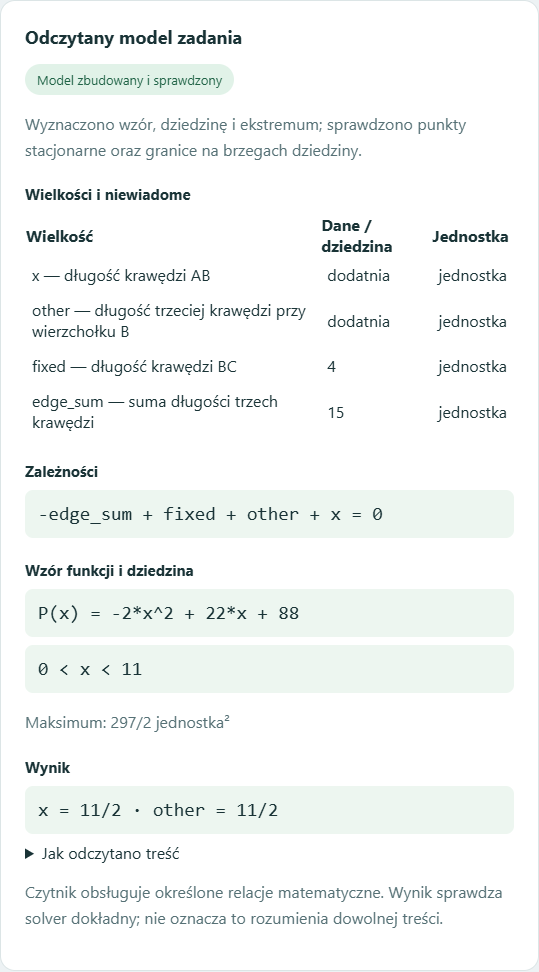
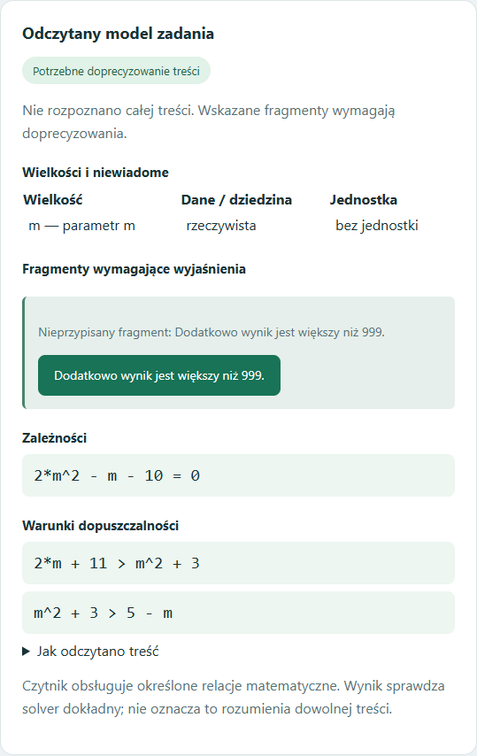

# Czytnik: wspólny model relacji — 17.10.2026

Nowa warstwa zapisuje treść zadania jako wielkości, dane, niewiadome, równania, warunki dopuszczalności oraz cel. Ten sam mechanizm rozwiązuje i sprawdza relacje z różnych dziedzin. Zachowuje fragmenty źródłowego tekstu, aby można było zobaczyć, skąd pochodzi dany warunek.

## Co działa

- Procenty jednej liczby, bilans wody i podział budżetu dwóch zespołów.
- Liczebności dwóch klas, udziały ułamkowe i ograniczenie do dodatnich liczb całkowitych.
- Trzywyrazowy ciąg arytmetyczny z warunkiem rosnącego, malejącego, niemalejącego, nierosnącego albo stałego porządku. Warunek słowny filtruje pierwiastki równania.
- Kąty trapezu prostokątnego: suma kątów i porównanie jednego kąta z sumą pozostałych.
- Stożek: tworząca i pełny kąt rozwarcia; objętość, wysokość, promień albo pole całkowite. Długości mogą mieć jednostkę mm, cm, dm lub m. Brak jednostki jest pokazany jako jednostka umowna.
- Prostopadłościan: podana krawędź i suma trzech krawędzi przy wierzchołku; wzór funkcji, jej dziedzina oraz maksimum albo minimum pola/objętości. Sprawdzane jest, czy wskazano rzeczywiste, różne krawędzie przy tym samym wierzchołku.

Przykłady:

> Wyznacz wartość m, dla której trzywyrazowy ciąg (2m+11, m^2+3, 5-m) jest arytmetyczny i malejący.

Wynik: m = 5/2. Drugi pierwiastek, m = −2, daje ciąg stały i zostaje odrzucony przez warunek malejącego porządku.

> Tworząca stożka ma długość 8. Kąt rozwarcia tego stożka ma miarę 120°. Oblicz objętość tego stożka.

Wynik: 64π jednostek objętości.

## Co pokazuje dashboard

Tabela wielkości i niewiadomych, odczytane równania, warunki, wynik oraz użyte fragmenty treści. W zadaniu optymalizacyjnym także wzór funkcji i dziedzina. Kliknięcie fragmentu wymagającego wyjaśnienia zaznacza go w polu zadania. Panel wyników działa w PL/EN; oryginalna treść zadania jest zachowana w języku wejścia.

Dodatkowy, nierozpoznany warunek zatrzymuje solver. Brak danych, sprzeczność, brak rozwiązania w wymaganej dziedzinie i nieosiągany kres są rozróżniane. Przykładowo minimum pola na otwartym przedziale nie jest ogłaszane jako osiągnięte tylko dlatego, że istnieje granica na brzegu.

## Wyniki i ich granice

| Sprawdzian | Wynik | Znaczenie |
|---|---:|---|
| Zachowane zadania CKE/ZPE | 10/10 | Znany zestaw naprawy, wcześniej 5/10; sprawdzono wartości, warunki, funkcję i dziedzinę, a nie tylko status odpowiedzi |
| Nowe warianty | 50/50 | Inne liczby, nazwy grup, kolejność zdań, cele i parametry; nie ślepy test dowolnego języka |
| Regresja funkcji projektu | 940/940 | Dotychczasowe i nowe testy; nie liczba niezależnych zadań egzaminacyjnych |
| Starszy obszerny zestaw ZPE | nadal 20 odpowiedzi / 204 przypadki | Bez utraty wcześniejszych odpowiedzi; wiele ćwiczeń nadal nieobsługiwanych, wymagających rysunku, konstrukcji lub dalszej interpretacji |

Zestaw 10 obejmuje zadania 8 i 22 egzaminu gimnazjalnego 2019, zadania 9, 15, 25 i 31 matury podstawowej z maja 2025 oraz ćwiczenia 11–14 materiału ZPE „Przed egzaminem — równania”.

Źródła: [CKE — gimnazjum 2019](https://egzaminy.gov.pl/cke/materialy-egzaminacyjne/egzamin-gimnazjalny?exam_session=2019), [CKE — matura maj 2025](https://egzaminy.gov.pl/cke/materialy-egzaminacyjne/egzamin-maturalny?exam=egzamin-maturalny&exam_session=2025-maj&formula=F2023), [ZPE — równania](https://zpe.gov.pl/a/przed-egzaminem---rownania/D1Hb4vfE2). Materiał ZPE: GroMar, CC BY-SA 3.0.

## Zakres przebudowy

To wspólna reprezentacja i dokładne wykonywanie obsługiwanych relacji z kontrolowanym odczytem zdań. Oryginalne wagi TSI pozostają bez zmian. Nowa warstwa nie jest uniwersalnym modelem językowym ani automatycznym treningiem na wszystkich arkuszach. Starsze czytniki zachowano dla wcześniejszych obsługiwanych zadań; migracja całego warsztatu do nowego zapisu nie jest zakończona.

Test bezpośredniego przesyłu do oryginalnego interfejsu potwierdził, że samo zdjęcie blokad długości i symboli nie tworzy równań matematycznych. Oryginalny rdzeń logiki poprawnie wykonuje sprawdzone struktury, natomiast matematyczny model treści wymaga odpowiedniego czytnika. Szczegóły: [audyt odczytu i rdzenia](ODCZYT_ZADAN_AUDYT_2026-10-17.md).
