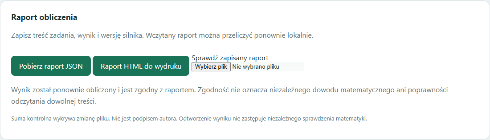

# Raporty obliczeń i ponowna weryfikacja — 17.10.2026

TSI potrafi zapisać wynik w formie przeznaczonej do przekazania innej osobie oraz ponownie przeliczyć zapisane zadanie. Funkcja działa w zadaniach tekstowych i narzędziach akademickich, w tym całkach, macierzach, logice i audycie.

## Obsługa

1. Oblicz zadanie. Pod formularzem pojawi się gotowość raportu.
2. Wybierz **Pobierz raport JSON**, aby zachować wejście, wynik i wersję silnika.
3. Wybierz **Raport HTML do wydruku**, aby zapisać czytelne wejście i wynik tekstowy w samodzielnym pliku. HTML nie wymaga połączenia z internetem; wykres nie jest kopiowany do tego raportu.
4. W polu **Sprawdź zapisany raport** wybierz JSON. TSI sprawdzi strukturę, sumę kontrolną i wersję, a następnie ponownie obliczy zadanie w osobnym procesie.

Zmiana danych lub przykładu blokuje eksport poprzedniego wyniku. Po nowym obliczeniu eksport jest ponownie dostępny. Interfejs raportów obsługuje PL/EN. Raport zawiera wpisaną treść i wynik; użytkownik decyduje o jego zapisaniu i przekazaniu. Odczyt i weryfikacja odbywają się lokalnie. Weryfikacja nie dodaje zadania do banku lekcji.



## Co potwierdza sprawdzenie

| Wynik | Znaczenie |
|---|---|
| `reproduced` | Ten sam silnik ponownie obliczył zgodny wynik |
| `modified` | Zawartość nie odpowiada zapisanej sumie SHA-256 |
| `engine_changed` | Kod lub opisane środowisko różnią się; nie wykonano porównania wyników |
| `result_changed` | Ponowne obliczenie dało inny wynik |
| `timeout` | Ponowne obliczenie przekroczyło 60 sekund |

Błędny format jest odrzucany. Limit pliku wynosi 2 MB, a zapisanych danych wejściowych 16 KiB. Rozmiary i składnia wejścia nadal podlegają ograniczeniom danego narzędzia. Raport potrafi zachować także odmowę lub wynik częściowy — odtworzenie takiego zapisu nie oznacza rozwiązania zadania.

Suma kontrolna wykrywa zmianę względem zapisanej sumy, ale nie jest podpisem ani dowodem autorstwa. Osoba modyfikująca plik może przeliczyć sumę; dlatego zgodność sumy nie zastępuje ponownego obliczenia. Test obejmuje właśnie taki przypadek: podmieniony wynik z nową poprawną sumą zostaje obalony przez rzeczywiste przeliczenie.

Zgodność wyniku nie jest niezależnym dowodem matematycznym i nie gwarantuje poprawnego odczytu dowolnej treści. Identyfikator silnika obejmuje kod narzędzi, deklarację aktywnego modelu, model relacji geometrii i wersje Python/SymPy. Nie jest pełnym audytem wszystkich zależności. Zmienione lekcje lub inne dane mogą zmienić wynik — w takim przypadku raport nie otrzyma potwierdzenia zgodności.

## Integracja i lokalna kontrola

Raport JSON ma wersjonowany format `tsi.computation-report/1`. Odpowiedzi `/api/story` i `/api/academic` dołączają go w polu `_report`. Lokalny endpoint `POST /api/reports/verify` przyjmuje zapisany raport i zwraca stan sprawdzenia. Pozostałe endpointy zachowują swój wcześniejszy limit 16 KiB.

W instalacji z kodem dostępna jest również kontrola bez dashboardu:

```text
python code/manager/computation_reports.py raport.json
```

Kod zakończenia: 0 dla odtworzonego wyniku, 1 dla niepotwierdzonego raportu, 2 dla błędu odczytu lub formatu. Oryginalne modele i bank użytkownika nie są modyfikowane przez odtwarzanie raportu.

## Weryfikacja wdrożenia

Dodano **20 testów** obejmujących integralność, zmieniony silnik, przekroczenie czasu, błędne formaty i wejścia, podmieniony wynik z poprawioną sumą oraz rzeczywiste ponowne obliczenia geometrii, całki, macierzy i logiki. Cała regresja: **1060 testów**.

W działającym dashboardzie sprawdzono pobieranie JSON i HTML, wczytanie i rzeczywiste przeliczenie raportu, odrzucenie zmienionego pliku, blokadę po edycji, PL/EN, widok mobilny oraz zachowanie wykresu całki. Portable zawiera moduł i interfejs raportów.
