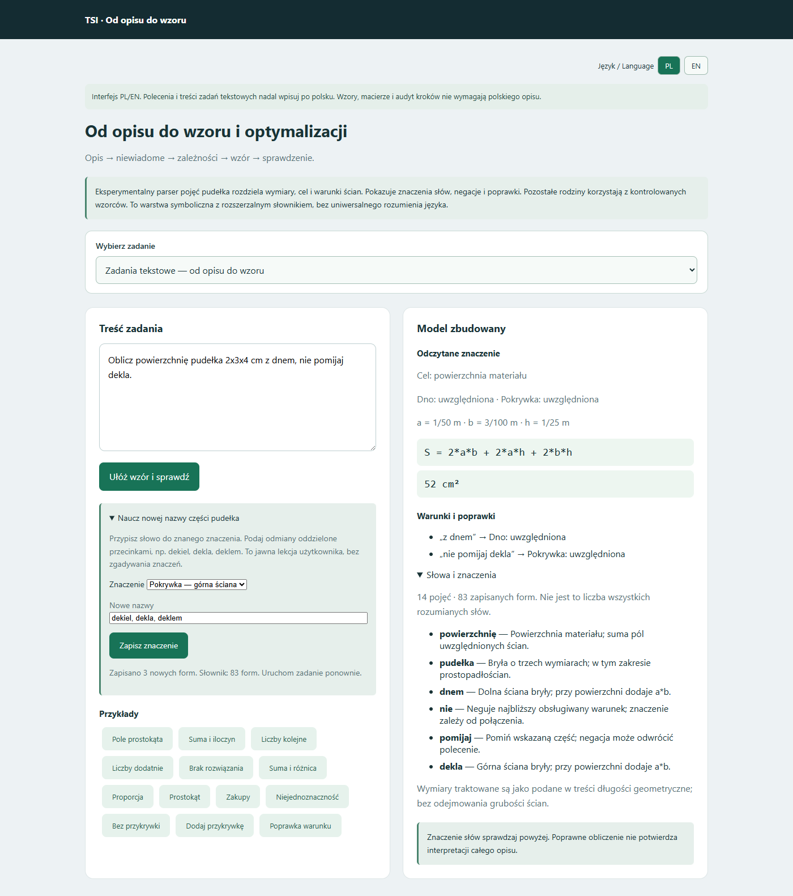

# Słowa i znaczenia — 16.10.2026

Dodano lokalny słownik początkowy: **14 pojęć, 83 jawne formy wyrazów** po lekcji „dekiel, dekla, deklem”. To liczba wpisów nowej warstwy pojęciowej, nie liczba słów rozumianych przez cały TSI. Starsze reguły obsługują dodatkowe odmiany i wzorce. Nie wyprowadzamy z tego oceny ogólnego rozumienia języka.

## Co można zrobić

W „Zadaniach tekstowych” otwórz **Naucz nowej nazwy części pudełka**. Wybierz dno albo pokrywkę i wpisz odmiany nowego słowa oddzielone przecinkami. Znaczenie jest zapisywane lokalnie w `meaning_lexicon.json`, z informacją o źródle lekcji. Kolejne zadanie odczytuje aktualny słownik bez restartu.

To uczenie nadzorowane słownictwa poprzez jawną deklarację znaczenia. Nie jest treningiem wag sieci, samodzielnym odkrywaniem znaczeń ani automatycznym rozumieniem dowolnego tekstu. Można rozszerzyć nazwy dwóch istniejących części. Nowe pojęcie matematyczne wymaga definicji, obsługi i niezależnych testów. Nieznanych słów nie przypisujemy do pojęć na podstawie samego podobieństwa pisowni.

Nowa warstwa rozdziela pojęcie obiektu, trzy wymiary z jednostkami, cel i warunki ścian. Obsługuje prostopadłościan/sześcian o czterech ścianach bocznych. Nie rozszerza automatycznie starszego parsera optymalizacji z arkusza ani innych rodzin zadań.

## Sprawdzian znaczenia

Pudełko 2 × 3 × 4 cm, z dnem:

| Warunek | Pokrywka w powierzchni | Powierzchnia |
|---|---|---|
| bez przykrywki | pominięta | 46 cm² |
| dodaj przykrywkę | uwzględniona | 52 cm² |
| nie uwzględniaj przykrywki | pominięta | 46 cm² |
| nie pomijaj przykrywki | uwzględniona | 52 cm² |
| nie pomijaj dekla, po lekcji | uwzględniona | 52 cm² |

Wynik pokazuje rozpoznane słowa i ich definicje, odczytane ściany, źródłowe warunki oraz jawne poprawki. Przy braku warunku podaje konkretną niewiadomą część i przycisk zaznaczający fragment opisu. Objętość geometryczna jest odróżniona od powierzchni i pojemności na ciecz: brak dna nie zmienia a*b*h, lecz uniemożliwia przypisanie zwykłej pojemności na wodę.

Przypisanie słowu „dno” znaczenia pokrywki jest odrzucane. Sprawdzane są też kolizje ze starszymi regułami odmian, np. „deneczko”. Zapis jest atomowy, a niepoprawna lekcja nie zmienia słownika. Znaczenia podane przez użytkownika są zaufanymi deklaracjami; program nie dowodzi ich poprawności językowej. Wieloznaczność i nieobsługiwane konstrukcje nadal wymagają doprecyzowania.

## Weryfikacja

50 przypadków parsera pojęć oraz 6 testów słownika (w tym trwałe rozszerzenie parsera po lekcji, negacje i odrzucenie kolizji). Starsze testy matematyki i modelowania: 326 przypadków. Osobno sprawdzono w przeglądarce prawdziwe żądania API, zapis lekcji, użycie nowego słowa, zaznaczenie fragmentu do doprecyzowania i układ na telefonie.

Próbę uczenia interpretacji całych zdań zatrzymano przed uzyskaniem raportu; nie aktywowano nowego modelu językowego. Wagi dotychczasowych modeli pozostają bez zmian. Nowa sekcja znaczeń i lekcji jest obecnie po polsku; istniejący przełącznik języka nie tłumaczy dowolnej treści słownika.

