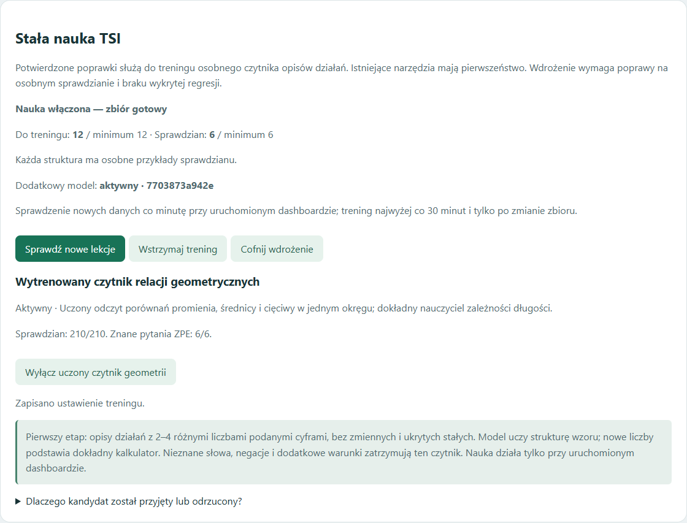
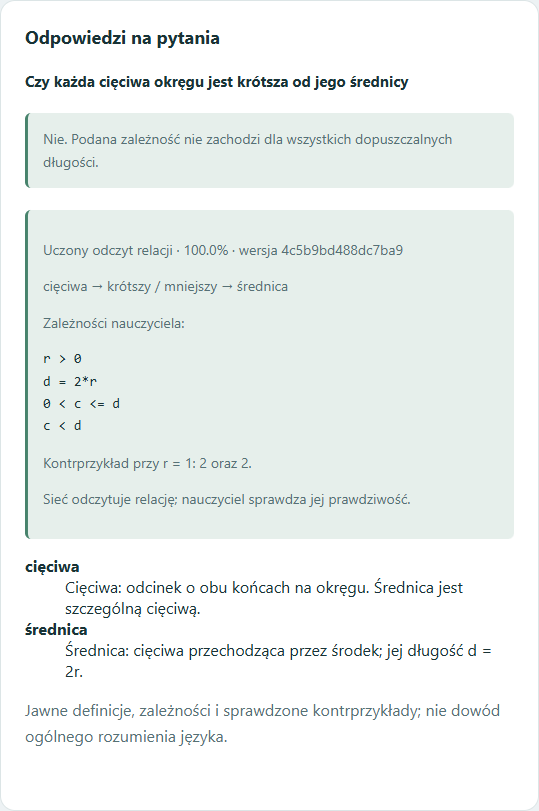

# Stała nauka i wytrenowane relacje geometryczne — 17 października 2026

## Wynik na rzeczywistych pytaniach

Sześć pytań z ćwiczenia 3 a–f materiału [Koła i okręgi — ZPE](https://zpe.gov.pl/a/kola-i-okregi/DKZd9Hdak) przed szkoleniem dawało 0/6 rozstrzygnięć, także po powtórzeniu. Po osobnym szkoleniu dodatkowego czytnika i wdrożeniu zakwalifikowanych wag dashboard udzielił 6/6 poprawnych odpowiedzi:

| Sprawdzana zależność | Odpowiedź |
|---|---|
| Promień dwa razy dłuższy od średnicy | Nie |
| Promień dwa razy krótszy od średnicy | Tak |
| Średnica dwa razy krótsza od promienia | Nie |
| Średnica dwa razy dłuższa od promienia | Tak |
| Każda cięciwa krótsza od średnicy | Nie — średnica też jest cięciwą |
| Wszystkie promienie jednego okręgu tej samej długości | Tak |

Źródło sprawdzianu: Zespół autorski Politechniki Łódzkiej / ZPE, CC BY 3.0. To znany test odbiorczy wskazany przez użytkownika, a nie ślepy test. Całe brzmienia tych sześciu pytań oraz ich warianty z innym mnożnikiem wyłączono ze zbioru treningowego i syntetycznych sprawdzianów.

## Co rzeczywiście zostało wyszkolone

Dodatkowa sieć uczy się ról odcinków i relacji: dłuższy/krótszy, wielokrotność oraz jednakowa długość. Wyjściem jest odczytana struktura porównania, nie zapamiętana odpowiedź na całe pytanie. Kontrola nazw, kierunku relacji i zakresu musi zgadzać się z siecią. Osobny dokładny nauczyciel rozstrzyga prawdziwość z r > 0, d = 2r oraz 0 < c ≤ d. Dla fałszu pokazuje dopuszczalny kontrprzykład. Wszystkie porównania dotyczą jednego okręgu.

- Lekcje: 600 syntetycznych zdań i 21 struktur relacji.
- Pierwsza próba liniowa: tylko 1/6 ZPE, odrzucona i zachowana w historii.
- Nowy czytnik: warstwa 64 neuronów, maksymalnie 800 kroków; zakończenie po 41 krokach według pewności wyłącznie na lekcjach.
- Starszy sprawdzian, po pierwszej próbie traktowany jako rozwojowy: 210/210.
- Dodatkowy świeży sprawdzian, zamrożony przed drugim treningiem: 210/210; zero błędnych zaakceptowanych odczytów.
- Pytania ZPE: 6/6. Osiem negatywnych kontroli: żadnej zaakceptowanej odpowiedzi.
- W przeglądarce sprawdzono też zamianę promieni na cięciwy i średnice, mnożniki 3 i 4, inny okrąg, uzasadnienia, PL/EN, wąski ekran i wyłączanie/włączanie czytnika.

To nie oznacza znajomości wszystkich figur ani dowodu rozumienia dowolnego opisu. Wspólny jest mechanizm odczytu relacji; nowe rodziny figur nadal potrzebują swoich własności i osobnego sprawdzianu. Negacje, dodatkowe warunki i nieznane słowa są zatrzymywane przez ten czytnik. Nowy kurs geometrii jest osobnym, wykonanym szkoleniem; okresowy trening z banku poprawek opisany niżej obejmuje na tym etapie działania liczbowe.

## Stały mechanizm podczas użytkowania

Panel `/lekcje` pokazuje liczbę lekcji i przykładów sprawdzianu, ostatni wynik, dodatkowy model oraz stan czytnika geometrii. Nierozpoznane zadania trafiają do prywatnej kolejki; same nie stają się poprawnymi etykietami.

Po potwierdzeniu poprawnego wzoru przykład może dostać automatyczny, stały przydział. Zmiana samych liczb nie przenosi tego samego brzmienia między treningiem a sprawdzianem. Nakładające się grupy są wyłączane z treningu.

Przy działającym dashboardzie nadzór sprawdza nowe dane co minutę. Automatyczny trening osobnej wersji odbywa się najwyżej co 30 minut, po zmianie zbioru. Przycisk pozwala zlecić osobny cykl ręcznie. Potrzeba minimum 12 lekcji i 6 osobnych przykładów sprawdzianu, co najmniej dwóch struktur i czterech lekcji dla każdej. Pierwszy zakres to opisy działań z 2–4 różnymi liczbami podanymi cyframi, bez ukrytych stałych i zmiennych; najwyżej 16 struktur i 2000 przydzielonych przypadków.

Wagi uczone są w osobnym procesie z limitem 120 sekund. Kandydat musi poprawić odczyt, osiągnąć co najmniej 90% poprawnych odpowiedzi na odłożonym sprawdzianie, nie zaakceptować błędnej odpowiedzi i zachować sprawdzone odczyty poprzednika. Błędne lekcje, sprzeczne interpretacje, negatywne kontrole, zmiana danych lub wyłączenie treningu w trakcie cyklu blokują wdrożenie. Ten sam automatyczny cykl nie powtarza się bez końca na niezmienionym zbiorze.

Nowo potwierdzona poprawka ujawniająca błędny odczyt aktywnego dodatkowego modelu powoduje cofnięcie do sprawdzonego poprzednika albo wbudowanego odczytu i wstrzymanie treningu. Można też ręcznie cofnąć wdrożenie oraz niezależnie wyłączyć czytnik geometrii. Wyłączenie nie usuwa wag. Zapisane wersje, raporty i ustawienia przetrwają ponowne uruchomienie.

Obecne narzędzia i rozpoznane zadania mają pierwszeństwo przed dodatkowym czytnikiem arytmetyki. Oryginalnych chronionych modeli TSI nie nadpisano. Brak odpowiedniej liczby potwierdzonych danych oznacza „czekam na lekcje”, nie sztuczny trening. W bazie użytkownika nie umieszczono syntetycznych lekcji demonstracyjnych.

## Weryfikacja i portable

Przed rozszerzeniem geometrii przeszły 743 testy regresji. Dodatkowo sprawdzono automatyczny proces treningu, wdrożenie, trwałość, wycofanie, blokadę regresji, zmianę danych podczas treningu, integralność modelu i pracę formularzy na izolowanej syntetycznej bazie. Końcowa regresja po integracji: **777/777 testów przeszło**.

Portable zawiera cały kod, dodatkowe wagi, kurs geometrii, protokół i raporty szkolenia. Nie zawiera prywatnej kolejki lekcji, zapisanych użytkowników ani bieżącego runtime. Trening wymaga uruchomionej aplikacji; po jej wyłączeniu nie jest usługą Windows. Kod i wagi pozostają lokalnie. GitHub otrzymuje dokumentację i zrzuty.

## Widoki

Panel poniżej pokazuje syntetyczną bazę testową, nie bazę użytkownika.

