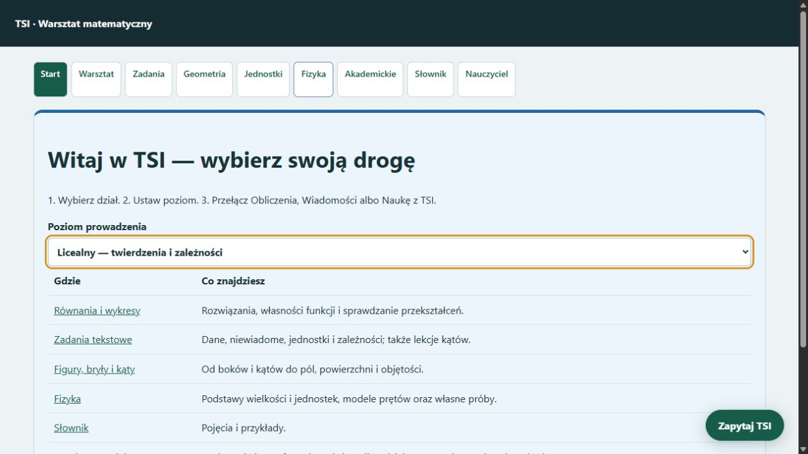
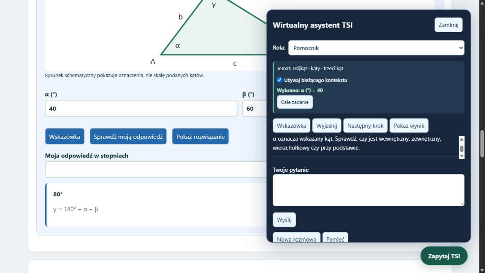

# Wirtualny asystent, lekcje i panel nauczyciela — 24 października 2026

## Działająca instalacja lokalna

Strona **Start** prowadzi przez działy i poziomy: podstawowy, licealny i akademicki. W menu startowym fizyka pojawia się na poziomie licealnym i akademickim. Nawigacja w działach zawiera stały przycisk fizyki. Wspólne tło, karty, pola danych, kolory trybów i przyciski oparto na panelu fizyki.

Jeden przycisk **Zapytaj TSI** otwiera okienko wirtualnego asystenta. Dawne rozmowy pod formularzami są ukryte. Do wyboru są role pomocnika, nauczyciela i narratora. Okienko zachowuje historię widoczną między stronami w tej samej karcie; nowa rozmowa ją czyści, zachowując osobną pamięć źródeł.

Po wykonaniu zadania asystent otrzymuje jego rodzaj i dane wejściowe. Potrafi omówić bieżące zadanie w równaniach, całkach, macierzach, zadaniach tekstowych, geometrii, fizyce i audycie kroków. Nie przenosi dowolnej poprzedniej odpowiedzi na nowy temat. Po zmianie danych stare obliczenie przestaje być kontekstem; pole trzeba ponownie obliczyć, by omawiać aktualny wynik.

Kliknięcie pola lub oznaczenia wybiera konkretny wymiar. Nagłówek okienka pokazuje temat i wybór, np. „Trójkąt · kąty · trzeci kąt” oraz „α (°) = 40”. Można wrócić do zakresu całego zadania. Przyciski wskazówki, wyjaśnienia, następnego kroku i wyniku korzystają z aktualnego narzędzia. Rola nauczyciela podaje najpierw wskazówki; wynik jest odsłaniany na wyraźną prośbę.

## Figury i poziomy

Przy 19 modelach figur i brył dodano podstawy nazw i części, wzory, role wielkości oraz rozróżnienie obwodu, pola, powierzchni i objętości. Poziom podstawowy prowadzi od rysunku i jednostek, licealny dodaje twierdzenia i relacje, akademicki przedstawia iloczyn skalarny, pole przez iloczyn wektorowy i wzór powierzchni parametrycznej. Nie wszystkie wzory z objaśnień są nowymi automatycznymi solverami.

Lekcja trójkąta obsługuje trzeci kąt, kąty trójkąta równoramiennego i równobocznego, trójkąt prostokątny, kąt zewnętrzny, twierdzenie cosinusów oraz kąt między niezerowymi wektorami. Dostępne są stopniowe wskazówki i sprawdzenie własnej odpowiedzi. Schemat pokazuje oznaczenia; nie udaje rysunku w skali podanych kątów.

Wybór trójkąta przełącza etap na „Figury i ich części”; wybór celu pomiarowego przełącza go na pomiary. Ćwiczenia kątowe są wiązane z własnościami figur. Bank zadań zmienia dział zgodnie z wyborem figury. Podstawy fizyki omawiają wielkości, jednostki, pole przekroju, siłę i zakres założeń modeli.

## Rozmowa o brakujących danych

„Policz kąt trójkąta” wywołuje pytanie o znane kąty, rodzaj trójkąta albo długości boków. W tym samym profilu odpowiedź „40 i 60” uzupełnia pytanie i prowadzi do 80°. Ujemne kąty, kąt zerowy, suma dwóch kątów co najmniej 180° i boki łamiące nierówność trójkąta są odrzucane. W trójkącie równoramiennym trzeba określić, czy znany jest kąt przy podstawie czy przy wierzchołku.

## Chroniony panel nauczyciela

**Nauczyciel** używa tego samego hasła co wcześniejszy panel poprawek. Jedna konsola zawiera zadania uczniów oraz poprawki i uczenie TSI. Nie zmieniano hasła użytkownika. Uczeń ma dostęp do opublikowanych ćwiczeń, nie do edycji ani ustawień treningu.

Zadanie ma dział, poziom, nazwę, treść, wskazówki i opcjonalny wzorzec odpowiedzi. Można je dodać, edytować, wycofać i przywrócić. Zmiany wersji chronią przed nadpisaniem zadania edytowanego w drugim oknie. Wzorzec odpowiedzi nie jest wysyłany w publicznej liście zadań.

Odpowiedzi obliczane przez lekcję kątów są sprawdzane przez jej solver. Jawny wzorzec liczbowy jest porównywany dokładnie, w tym ułamek z liczbą dziesiętną. Otwarte wypowiedzi bez wzorca oraz odmienne zapisy wymagające interpretacji pozostają do oceny nauczyciela. Bank ćwiczeń nie uruchamia sam treningu wag.

## Wyniki sprawdzianów

| Zakres | Wynik |
|---|---:|
| Obliczenia kątów, nieprawidłowe dane, role i bank nauczyciela | 36/36 |
| Działająca aplikacja: strony, rozmowa, lekcje, hasło, macierze i fizyka | 20/20 |
| Wspólny interfejs kontekstu — narzędzia i wybrany wymiar | 12/12 |
| Działający asystent — rozmowa, uzupełnienie danych, figury, całki, macierze, fizyka i ochrona hasłem | 12/12 |

W przeglądarce potwierdzono też pojawienie się fizyki po wybraniu liceum, przełączenie etapu po wybraniu trójkąta, widoczność okienka i odpowiedź dotyczącą wskazanego α=40°. Testy używały danych przykładowych; nie edytowano rachunków ani prywatnego banku użytkownika.

## Zakres wdrożenia

Zmiany są w instalacji roboczej. Wagi TSI nie zostały zmienione ani ponownie wytrenowane w ramach tego etapu. Swobodna rozmowa nie osiągnęła wymaganego poziomu. Opcjonalne zewnętrzne AI przez API pozostaje do podłączenia; obecnie nie wysyłamy tych zadań do zewnętrznego modelu. ZIP i osobne katalogi portable nie zostały w tym etapie przebudowane.

