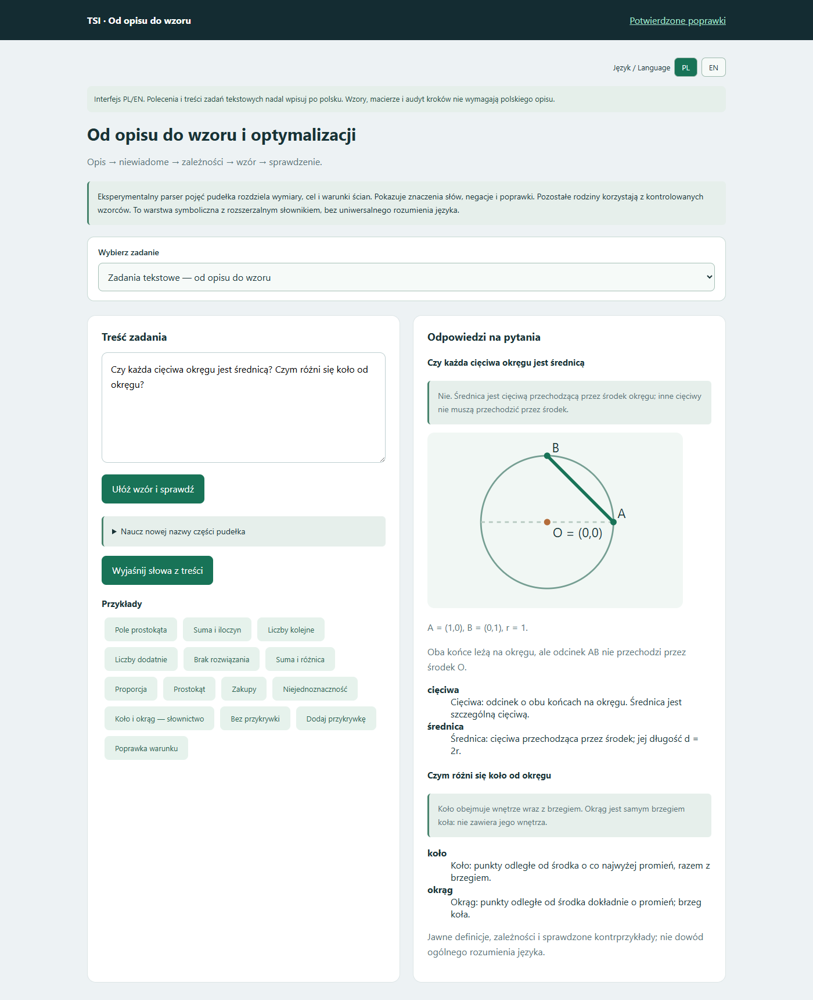
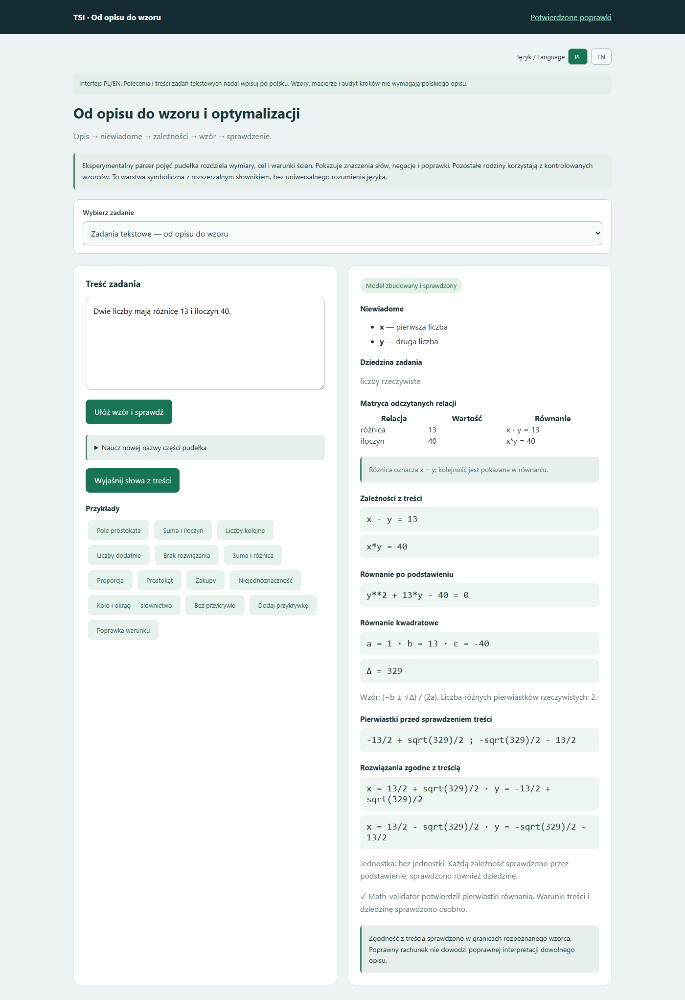

# Zmiana treści zadania i audyt — 16 października 2026

## Poprawione zgłoszenia

- „Dwie liczby mają różnicę 13 i iloczyn 40”: niezależny odczyt relacji daje x−y=13 oraz x·y=40. Obie rzeczywiste pary przechodzą podstawienie i dotychczasowy walidator. Suma, różnica, iloczyn i iloraz mogą być łączone w różnej kolejności. Kolejność różnicy i ilorazu jest jawna; mianownik nie może być zerem.
- „Czy każda cięciwa okręgu jest średnicą? Czym różni się koło od okręgu?”: dwie osobne odpowiedzi, definicje i sprawdzony kontrprzykład z cięciwą nieprzechodzącą przez środek. Odwrócenie pytania o średnicę daje inną odpowiedź.
- Wspólny formularz kieruje opisy wielkości geometrycznych do solvera geometrii. Zamiana pola na obwód zmienia cel; brak wysokości wskazuje konkretną brakującą wielkość.
- Audyt: tożsamość wymaga jednego równania, porównanie kroków 2–10. Dwa wiersze w trybie tożsamości dają wyjaśnienie właściwego trybu przed wysłaniem. Treść nie jest automatycznie zmieniana. Edycja oznacza przykład jako własne równania.
- Dla x*(x−1)=0 → x+1=0 audyt kroków wskazuje utracone rozwiązania {0,1} i dodane {−1}. Błędne dane są wyjaśnione także w panelu wyniku.

## Sprawdzenie zmian zamiast powtarzania przykładów

Nowe 39 testów obejmuje odwrócenie relacji, inne wartości i znaki, dodanie trzeciego warunku, usunięcie warunku, założenia dziedziny, odwrócone i równe granice całki, mniejsze macierze, pole/obwód i zadania odwrotne. Sprawdzono również zmiany operatorów logiki.

W przeglądarce odtworzono dokładny przypadek audytu użytkownika, trzy pary relacji liczbowych, dwa pytania pojęciowe, zmianę pola na obwód, przełączenia narzędzi, operacji macierzowych, granic całek, operatorów logiki i pięć przykładów audytu. Nie wystąpiły błędy JavaScript w tych przebiegach.

Regresja narzędzi akademickich, geometrii, matryc i nowych modułów: 489 testów przeszło. Dodatkowy zestaw starszych zadań, optymalizacji i modułu tabel: 232 poprawne przypadki oraz dwa wykryte niepowodzenia. Dotyczyły przedstawiania częściowego odczytu jako gotowych równań przy brakujących lub dodatkowych warunkach. Poprawiono rozróżnienie; ponowny test całej dotkniętej rodziny i nowych wariantów: 156/156. Liczby zestawów częściowo się pokrywają — nie sumujemy ich.

## Granice

To rozszerzenie parsera relacji, jawnych definicji i kierowania do istniejących narzędzi; nie nowy trening wag ani rozumienie dowolnego języka. Nieznane lub dodatkowe warunki wymagają doprecyzowania. Testy obejmują wymienione rodziny, a nie wszystkie możliwe zadania. Brak drugiej relacji nie uprawnia do zgadywania dwóch liczb. Dokumentacja publiczna nie zawiera kodu, wag ani danych użytkownika.

## Widoki

